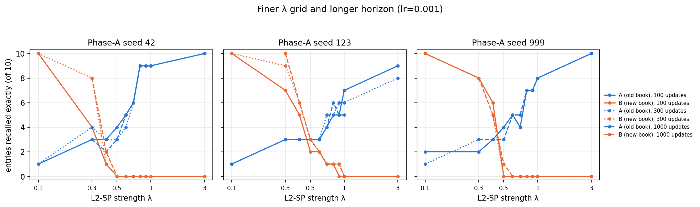
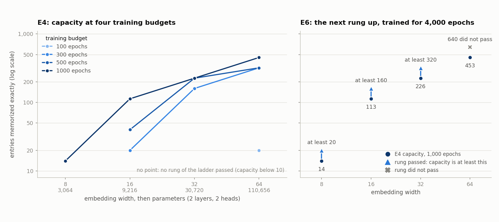
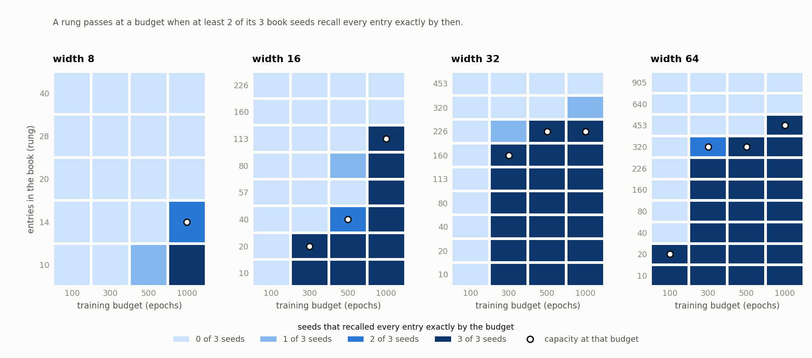
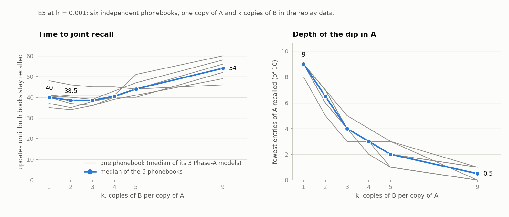
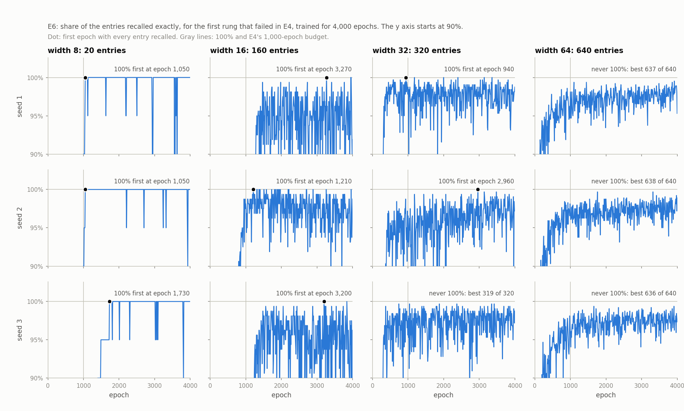

# Phonebook forgetting: what the experiments show

*Status as of Friday November 13, 2026. Protocol, per-experiment results and audits:
[`experiments/week_2026-10-07/README.md`](experiments/week_2026-10-07/README.md) (E1 to E3),
[`experiments/week_2026-10-31/README.md`](experiments/week_2026-10-31/README.md) (E4 capacity, E5 replay ratio, E6 longer training) and
[`experiments/week_2026-11-13/README.md`](experiments/week_2026-11-13/README.md) (E7 weight decay and learning-rate step-down).
Derived tables and figures: [`results/`](results/).*

## The question

A small transformer (64 dimensions, 2 layers, 2 attention heads, 110,528 parameters) memorizes the
phone numbers of one phonebook (phase A, ten entries) and is then adapted to a second one (phase B,
ten entries). Plain adaptation forgets the first book. Two remedies are compared: **balanced
replay** (keep training on A while learning B) and **L2-SP** (penalize drifting from the phase-A
weights; needs no old data). A second question comes from the course README: if the replay data
holds one copy of A and k copies of B, which k reaches 100% on all the data fastest? A third
comes from the same README: what is the capacity of a very small model, that is, how many entries can it
memorize before 100% exact recall becomes impossible? A fourth comes from the answer to the third: when E6 trained longer, the
wide models reached 100% only on isolated epochs and the widest never did, so what stops them from holding it, the weight decay or the
size of the learning-rate step (E7)?

An entry counts as *recalled* only if greedy generation from its name produces the whole phone
number and the newline, with no length hint. Counts are entries recalled out of ten per book.

## Findings

1. **Replay learns both books.** At the trainer's default learning rate (0.001), balanced replay
   recalls 10 of 10 entries of A and of B after 100 and after 300 updates on all three phase-A
   checkpoints of the original phonebook (E1) and on three new phonebooks (E2). Both books are
   first recalled together at update 33 to 51 (E1) and 36 to 48 (E2), after A
   dips to 8 to 9 of 10. Plain fine-tuning ends with B at 10 and A at 0: B is first complete
   at update 31 to 44 and A is down to 0 by update 12 to 19.
2. **No L2-SP strength matches replay.** On the original phonebook (E1, nine strengths from
   λ = 0.01 to 100), on a finer grid trained for 1000 updates (E1b) and on the new phonebooks
   (E2), the pre-registered rule (one λ with A = 10 and B = 10, or A ≥ 9 and B = 10, on at least two
   of three checkpoints) gives "no" every time. L2-SP trades one book for the other along λ, with
   the change between λ = 0.3 and λ = 1: whenever a run kept at least 8 of A's entries it recalled 0
   of B's, and whenever it recalled at least 8 of B's it kept at most 4 of A's.
3. **Repeating B (the README's question).** With one copy of A and k copies of B, the smallest median
   time to joint recall is at k = 3 for lr = 0.003 and 0.001 and at k = 5 for lr = 0.0003 and
   0.0001, so in the medians k > 1 is faster at every learning rate, but only by 2 to 22 updates (5% to 18%): the
   choice among k = 2, 3, 5 is not resolved, and k = 9 is not faster. The temporary dip in A deepens
   with k (at lr = 0.001 the median fewest A entries recalled is 8, 5, 3, 1, 1 for
   k = 1, 2, 3, 5, 9). The learning rate matters far more than k.
   **E5 then repeated this on six independent phonebooks with a measured noise band of 0.** At lr = 0.001 the
   median time to joint recall is 40.0, 38.5, 38.5, 40.5, 44.0, 54.0 updates for k = 1, 2, 3, 4, 5, 9. By the
   pre-registered rule (which is a sign rule when the noise band is 0) only k = 2 beats k = 1: faster in 5 of 6
   phonebooks, by a median of 1.5 updates (about 4%). k = 3 ties it in the median, k = 4 and k = 5 are slower,
   k = 9 is 15 updates slower, the dip in A deepens monotonically (9, 6.5, 4, 3, 2, 0.5 entries kept), and k = 1 is
   by far the cheapest in sequences processed (800 against 1155 for k = 2).
4. **Counts in the regime-change region are noisy by about one entry.** Two runs that differ only
   in how often accuracy is logged have different shuffle orders of the training batch, and exact
   counts at the same update differ by one entry at about one in five updates there, rarely more.
   This failed a pre-registered cross-check (E1b against E1); its cause was then tested (d1).
5. **Capacity (the README's other question).** A 2-layer, 2-head model trained from scratch memorizes, within 1000
   epochs at lr = 0.001 and with the exact-recall criterion, 14, 113, 226 and 453 random name-to-number entries at
   widths 8, 16, 32 and 64 (3,064 to 110,656 parameters), which is 0.13 to 0.40 bits per parameter, far below one bit.
   The limit is mostly training time, not room: the first full recall of 10 entries comes at epoch 470 to 790, 200 to 220,
   110 to 120 and 60 to 70 for the four widths, the capacity at 500 epochs is smaller than at 1000 for three of the four, and
   the narrow models were still improving at epoch 1000. The wide models' next rung up flattened at 96% to 99% of its
   entries. No control entry was ever recalled. This is a capacity at a budget, not an asymptotic capacity.
   **E6 then trained the first failing rung of each width for 4000 epochs** (same books, seeds and settings; the first 1000 epochs reproduce E4's).
   It passes for widths 8, 16 and 32 (20, 160 and 320 entries), so those E4 capacities were budget limits and are now at least 0.21, 0.57 and 0.34
   bits per parameter, still under one. It does not pass for width 64: 640 entries reached at most 636 to 638 correct, and the mean accuracy rose
   by 0.7 points between epochs 1001-2000 and 3001-4000, so that rung is neither shown possible nor shown impossible. At widths 16 and 32 the 100%
   is reached only at isolated logged epochs (1 to 21 of 400 for the seeds that reach it) and none of those six runs is at 100% at epoch 4000; only the
   width-8 runs hold it. No width has been shown to have an impossible rung. E7 (finding 6) then asked what stops the wide models from holding 100%.
6. **What stops the wide models from holding 100% (E7).** E6 left the wide models reaching 100% only on isolated epochs (width 64 never) and varied nothing but
   the length of training. E7 retrains the same three rungs for 4000 epochs (160, 320 and 640 entries at widths 16, 32 and 64; the same books and seeds; E6's
   weight decay is 0.1 and its learning rate a constant 0.001) with exactly one optimizer setting changed: **arm W** sets the AdamW weight decay to 0.0, **arm S**
   multiplies the learning rate by 0.1 after epoch 2000 (its first 2000 epochs equal E6's at every logged epoch, in all nine runs). All 18 runs reach 100% and all 18
   are at 100% at epoch 4000 (E6: none of its nine runs at these widths). Every rung passes at 4000 epochs, including width 64's 640 entries, which E6 never passed:
   arm W by epoch 2000 at every width, arm S by 3000 (six of its nine runs first reach 100% at epoch 2010, the first logged epoch after the cut). The runs also hold it
   (at least 50 of the last 100 logged epochs at 100%): arm S in 9 of 9 runs, arm W in 8 of 9. The exception is arm W at width 16 with seed 1, which reaches 100% only on
   isolated epochs (13 of the last 100), as in E6, although it ends at 100%. Two arm W runs at width 64 dip after 500 epochs at 100%, to 390 of 640 (epochs 3700 to
   3740) and to 25 of 640 (epochs 3900 to 3990), and are back at 640 of 640 at epoch 4000, so arm W's mean accuracy at width 64 over epochs 3001 to 4000 is 0.9928, no
   higher than over 1001 to 2000 (flat). Width 64 now has at least 0.188 bits per parameter (E4: 0.133). No control entry was recalled. Two of the ten pre-registered
   tripwires fired, with readings written before the runs: arm W passes at width 64 ("the decay was the binding limit even at the widest model, E6's width-64
   shortfall was not a time or capacity limit"), and both arms hold in more seeds than E6 at widths 16 and 32 ("either setting is enough to help; arm S cannot say whether
   the step size or the lower decay did it (it changes both), and only arm W shows that the decay alone is enough"). 41 of the 44 scored predictions hit; the three misses all
   concern arm W (width 16: 2 holding seeds, not 3; width 64: a late mean of 0.9928 against a locked range of 0.9934 to 1.0; and the contrast between the arms that follows from the first).
   This is one learning rate, one schedule, three book seeds and random name-to-number data, and arm S changes the step size and the per-step decay together, so which of the two did
   the work in arm S is not separated.

## Claims and evidence

| # | Claim | Status | Evidence |
|---|---|---|---|
| 1 | At lr = 0.001, balanced replay recalls both books exactly at 100 and 300 updates | Established on this task, replicated on 3 new phonebooks | [`e1_endpoints.csv`](results/e1_endpoints.csv), [`e2_endpoints.csv`](results/e2_endpoints.csv) |
| 2 | Plain fine-tuning at lr = 0.001 ends with B 10 of 10 and A 0 of 10 | Established, replicated | same files; timing in the experiment README |
| 3 | No tested L2-SP strength matches replay at lr = 0.001 | Established for isotropic L2-SP: λ from 0.01 to 100 at 100 and 300 updates, and λ from 0.3 to 1 also at 1000 | [`e1_decision.json`](results/e1_decision.json), [`e1b_decision.json`](results/e1b_decision.json), [`e2_decision.json`](results/e2_decision.json) |
| 4 | L2-SP shows a trade-off with no λ that keeps A and learns B (A ≥ 8 implies B = 0; B ≥ 8 implies A ≤ 4) | Established on these runs | [`e1b_fine_grid.png`](results/e1b_fine_grid.png), [`e2_dose_response.png`](results/e2_dose_response.png) |
| 5 | k > 1 reaches joint recall slightly sooner than k = 1 at every learning rate; k = 9 does not | Observed in the medians at every learning rate; small; run-to-run timing noise not measured; the paired sign tests are exploratory | [`e3_table.csv`](results/e3_table.csv), [`e3_cells.csv`](results/e3_cells.csv) |
| 6 | Any particular k among 2, 3, 5 is best | **Not established in E3; E5 narrows it**: k = 2 and k = 3 tie in the median (38.5), k = 2 is faster than k = 1 in more single runs (15 of 18 against 10 of 18), k = 5 is slower | [`e3_heatmaps.png`](results/e3_heatmaps.png), [`e5_analysis.json`](results/e5_analysis.json) |
| 7 | Counts near the L2-SP regime change carry about one entry of numerical noise | Measured in E1b against E1; d1 shows the logging interval alone changes the trajectory. For replay timing at lr = 0.001, E5 found no variation at all under five other shuffle seeds (noise band 0) | [`d1_logging_interval/`](experiments/week_2026-10-07/d1_logging_interval/), [`e5_analysis.json`](results/e5_analysis.json) |
| 8 | L2-SP is the more promising direction; replay's trade-off is binary | **Retracted** (see below) | [`sweep_lr/README.md`](sweep_lr/README.md) Parts 9 and 10 |
| 9 | Other regularizers (EWC), other model sizes for the replay question, larger or other kinds of data | **Not tested** | |
| 10 | At lr = 0.001, k = 2 reaches joint recall slightly sooner than k = 1 (about 1.5 updates, 5 of 6 phonebooks); no other k does; k = 9 is much slower | Established by the pre-registered rule on six phonebooks (E5); small, and the rule is a sign rule because the noise band is 0 | [`e5_analysis.json`](results/e5_analysis.json), [`e5_cells.csv`](results/e5_cells.csv), [`e5_prediction_scores.json`](results/e5_prediction_scores.json) |
| 11 | A 2-layer, 2-head model memorizes 14, 113, 226 and 453 random entries at widths 8, 16, 32, 64 within 1000 epochs | Established for this budget, learning rate and exact-recall criterion, with three book seeds per rung | [`e4_capacity.json`](results/e4_capacity.json), [`e4_cells.csv`](results/e4_cells.csv), [`e4_prediction_scores.json`](results/e4_prediction_scores.json) |
| 12 | Capacity is limited by training time more than by parameter count | Supported: E4 (narrow models still improving, boundaries moving, 0.13 to 0.40 bits per parameter) and E6 (at 4000 epochs the rung above the E4 capacity passes at widths 8, 16, 32); not shown for width 64, whose 640-entry rung still fails | same files, [`e6_capacity.json`](results/e6_capacity.json), [`e6_extension.json`](results/e6_extension.json); E7 changes the width-64 picture (rows 17 to 19): that rung passes with weight decay 0.0 or a step-down |
| 13 | Capacity is an asymptotic property of the model, or some rung is impossible for a width | **Not established**: 1000 and 4000 epochs, constant lr 0.001, weight decay 0.1; width 64's 640-entry rung is still rising slowly at 4000 (best 636 to 638 of 640) and the rungs above E6's passes were not run | [`e6_extension.json`](results/e6_extension.json); in E7 the 640-entry rung passes with weight decay 0.0 or a step-down (rows 17 to 19), and the rungs above the passes are still not run |
| 14 | At 4000 epochs the first rung that failed in E4 passes at widths 8, 16, 32 (20, 160, 320 entries) and not at width 64 (640 entries) | Established by the pre-registered rule (2 of 3 book seeds, first epoch at 100%) on E4's books; 17 of 17 locked predictions hit, 8 exactly | [`e6_cells.csv`](results/e6_cells.csv), [`e6_prediction_scores.json`](results/e6_prediction_scores.json) |
| 15 | A wide model keeps 100% exact recall of a book at the rung where it first reaches it | **Not true in E6**: at widths 16 and 32 the 100% is isolated (1 to 21 of 400 logged epochs for the seeds that reach it) and none of the six runs is at 100% at epoch 4000; width 8 holds it (all three runs) | [`e6_extension.json`](results/e6_extension.json), [`fig_e6_curves.csv`](results/fig_e6_curves.csv) (the count of logged epochs at 100% is made from it); E7 varies the decay and the step (rows 17 to 19) |
| 16 | The entries memorized amount to 0.13 to 0.40 bits per parameter within 1000 epochs (widths 8, 16, 32, 64) and, at 4000 epochs, to at least 0.21, 0.57 and 0.34 bits per parameter (widths 8, 16, 32): below one bit per parameter in every case | **lower bound**: every capacity is a lower bound (E6 lifted three of E4's, and the rung above E6's passes was not run); a bit is counted in the phone number only (32.575 bits per entry), and parameters are the median over the three book seeds at the capacity rung | [`e4_capacity.json`](results/e4_capacity.json), [`e6_capacity.json`](results/e6_capacity.json) |
| 17 | In E7, with the AdamW weight decay at 0.0 instead of 0.1 (arm W) or with the learning rate cut to a tenth after epoch 2000 (arm S), the first rung that failed in E4 passes at widths 16, 32 and 64 (160, 320 and 640 entries), including width 64, which E6 never passed; all 18 runs are at 100% at epoch 4000 | Established by the pre-registered rule (2 of 3 book seeds, first epoch at 100%) on E4's books: arm W passes by epoch 2000 at every width, arm S by 3000; the 24 locked predictions on seeds perfect, passing, first passing budget and ending at 100% all hit (18 exactly) | [`e7w_extension.json`](results/e7w_extension.json), [`e7s_extension.json`](results/e7s_extension.json), [`e7_scores.json`](results/e7_scores.json), [`e7w_cells.csv`](results/e7w_cells.csv), [`e7s_cells.csv`](results/e7s_cells.csv) |
| 18 | In E7 the models hold their 100% (at least 50 of the last 100 logged epochs, 3001 to 4000, at 100%): arm S in 9 of 9 runs, arm W in 8 of 9; E6 held in none of its nine runs at these widths | Established by the pre-registered holding rule on E4's books, with one exception that the rule shows: **arm W at width 16 with seed 1 does not hold** (13 of 100: isolated 100%, as in E6, though it ends at 100%); two arm W runs at width 64 dip after settling (to 390 and to 25 of 640) and recover by epoch 4000; 5 of the 6 locked holding lines hit | [`e7w_extension.json`](results/e7w_extension.json) (`epochs_at_100`), [`e7s_extension.json`](results/e7s_extension.json), [`e7_scores.json`](results/e7_scores.json) |
| 19 | The weight decay (0.1) is what kept the wide models from passing at width 64 and from holding 100% at widths 16 and 32 in E6 | **Supported**: with the decay at 0.0 and nothing else changed from E6 (arm W) the rung passes at width 64 and the models pass at all three widths and hold at 32 and 64 (at 16 in 2 of 3 seeds), where E6 did not; the pre-registered readings of the two tripwires that fired (`w_d64_passes`, `both_large`) say the same; not shown: that the decay is the only factor, that 0.1 is special, or anything at other shapes, learning rates or data; three book seeds | [`e7w_extension.json`](results/e7w_extension.json), [`e6_extension.json`](results/e6_extension.json), [`e7_scores.json`](results/e7_scores.json) |
| 20 | In arm S the lower step size, rather than the lower weight decay, is what lets the models hold 100% | **Not established**: arm S lowers the step size and, because AdamW decays every weight by learning rate times weight decay, the per-step decay together; only arm W isolates the decay, and a step-down that keeps the per-step decay was not run | [`e7s_extension.json`](results/e7s_extension.json), [`e7_scores.json`](results/e7_scores.json) |

## What was retracted

The September 29 synthesis (sweep README Parts 8 and 9) concluded that replay learns none of book
B while L2-SP's partial learning of B made L2-SP the direction to pursue. On October 4 an audit found
that it compared L2-SP's B *token* accuracy with replay's B *exact* recall, and that replay had
been run at lr = 0.0001 for 100 updates, which is too little for B (Part 10). This week's
experiments tested the question properly: at lr = 0.001 replay recalls both books and no L2-SP
strength does (findings 1 and 2).

## Figures







Left: the capacity of a 2-layer, 2-head model at widths 8 to 64 after 100, 300, 500 and 1000 epochs (E4); a width has no point at a budget where
no rung of the ladder passed. Right: the first rung that failed at 1000 epochs, trained for 4000 epochs (E6). At widths 8, 16 and 32 it passed, so the
capacity is at least that rung (the rung above it was not run); at width 64 the 640-entry rung did not pass.
Table: [`fig_e4_capacity.csv`](results/fig_e4_capacity.csv).



For each width, how many of the 3 book seeds recalled every entry of a rung exactly by each budget; a rung passes with 2 of 3, and the dot marks the
capacity at that budget. The boundary was still moving between 500 and 1000 epochs at widths 8, 16 and 64 and was stable at width 32.
Table: [`fig_e4_passmap.csv`](results/fig_e4_passmap.csv).



E5 at lr = 0.001 on six independent phonebooks: gray lines are single phonebooks (the median of their 3 Phase-A models), blue is the median over the six.
Only k = 2 beats k = 1 under the pre-registered rule (faster in 5 of 6 phonebooks, by a median of 1.5 updates), and the dip in A deepens as k grows. The vertical
axes start at 0, so the small difference at k = 2 looks as small as it is. Table: [`fig_e5_replay_k.csv`](results/fig_e5_replay_k.csv).



E6: the share of the entries recalled exactly at each logged epoch, for each width (columns) and book seed (rows), at the rung that first failed in E4.
Width 8 ends at 100% in all three runs, with brief dips; at widths 16 and 32 the 100% is reached only on isolated logged epochs (the dot is the first), and
seed 3 of width 32 never reaches it; width 64 never does (best 636 to 638 of 640). The vertical axis starts at 90%.
Table: [`fig_e6_curves.csv`](results/fig_e6_curves.csv).

## Limits

- One task type (20 random names and phone numbers, ten entries per book), one model size, one
  optimizer setting apart from the learning rate; counts move in tenths, so a one-entry difference
  is small.
- Three Phase-A checkpoints of one phonebook (E1, E1b, E3) and three new phonebooks (E2), one
  shuffle stream per run. Medians in E3 are over three checkpoints. E5 adds six independent phonebooks
  (the unit of replication, three Phase-A inits each) and measured the shuffle noise (0). E4 uses three book seeds per rung.
- L2-SP here is the isotropic penalty from the mitigation notes. A "no" is not a claim about every
  regularizer; a Fisher-weighted penalty (EWC) was not tried.
- E3 counts updates, not work: at k = 5 each update processes 60 sequences against 20 at k = 1. E5 reports both.
- Capacity is read at 1000 epochs (E4) and, for the first failing rung of each width, at 4000 (E6), with a constant learning rate and an
  exact-recall criterion that counts the first epoch at which every entry is recalled, even if the model falls back afterwards (at widths 16 and 32 it does).
  The ladders step by about 1.4x near each capacity (the next rung is 1.41 to 1.43 times larger; the ladders of widths 16, 32 and 64 start with steps of 2), so a capacity is known only to the nearest rung, and several rest on a cell finishing at the edge of a budget.
  Every capacity is a lower bound: E6 lifted three of E4's, and the rung above E6's passes was not run. Width 64's 640-entry rung did not pass in 4000
  epochs but was still rising, so no impossible rung has been shown for any width. In E4 and E6 the learning rate, schedule and weight decay were not varied. E4 and E6 vary only the width
  (2 layers and 2 heads throughout) and set it on the trainer command line, leaving `phonebook/config/phonebook.py` at its defaults. The scratch calibration behind the E6
  predictions (8 runs, not evidence) is archived in [`calibration/`](calibration/README.md), added after the write-up.
- E7 varied the AdamW weight decay (0.0) and the learning-rate schedule (a tenfold step-down after epoch 2000), one at a time, at widths 16, 32 and 64, on E6's books with three book seeds per cell;
  the learning-rate level, batch size, gradient clipping, shape and kind of data were not varied. "Holds" means at least 50 of the last 100 logged epochs at 100%, a rule fixed before the runs. Arm S lowers
  the step size and, because AdamW decays every weight by learning rate times weight decay, the per-step decay together, so only arm W isolates the decay. Arm W at width 64 dips after settling in two of
  three runs, so its late mean accuracy is below 1 although every run ends at 100%, and one arm W run at width 16 does not hold. In E7 the 640-entry rung passes at width 64; the rungs above the
  passes were not run, so the capacities are still lower bounds. The scratch calibrations behind the E7 predictions (12 runs of the two settings on a throwaway book, plus the E6 calibration; not evidence)
  are described in the predictions file and are not archived in the repository.
- Replay uses old data and L2-SP does not, so "replay wins" says nothing about the case where old
  data are unavailable, only that isotropic L2-SP does not rescue it here.

## Next steps (candidates, not promises)

1. A Fisher-weighted penalty (EWC), and replay of only a fraction of A, to see what is needed
   when old data are limited.
2. The rungs above E7's passes (226, 453 and 905 entries at widths 16, 32 and 64, the next ones on the ladders) and capacity beyond 4000 epochs, now that the weight decay is known to
   matter; a step-down that keeps the per-step decay (the weight decay raised tenfold at the cut) to separate the step size from the decay in arm S; weight decays between 0 and 0.1 to see how
   much is too much; and other shapes (layers, heads).
3. Other kinds of data than random phone numbers.

## Checking this

Every experiment is a committed spec in [`specs/`](specs/) with predictions or rules fixed before
the runs, and a separate audit script (code written apart from the runner, not a third party) covered every run of the weeks of
October 7, November 3 and November 13: 609 training runs and 37,602 generated answers, all consistent (the 432 runs of the week of November 3 are in
[`experiments/week_2026-10-31/`](experiments/week_2026-10-31/README.md); one of those audits failed at PyTorch's default
thread count on a 1.4e-6 relative loss difference and passes at the training thread count, as that README explains; since November 4 the audit compares the loss within a relative 1e-5 and everything else exactly, and passes at both thread counts). The 18 runs of the week of November 13 (E7, [`experiments/week_2026-11-13/`](experiments/week_2026-11-13/README.md)) were audited with their
weights (7,080 answers) and, in a fresh clone, without them. The 8 runs
of the week of September 30 (400 answers) were audited by that week's own earlier script.
From a fresh clone, the committed files alone can be re-audited (run from the repository root):

```bash
python phonebook/audit_experiment.py --root phonebook/experiments/week_2026-10-07/e3_replay_ratio
```

This reconciles the manifest, protocol, the spec at its recorded commit, the summaries, the logged
metrics and the saved raw answers (each re-scored from the strings). The model weights are not
committed; with them in place, `--require-local-artifacts` also re-generates every answer from the
saved weights, which is how the audits recorded in each folder were run. One pre-registered check
failed, E1b against E1; it is reported as failed in the experiment README with its tested cause
(d1).

Study and defense sheets for the replay-ratio experiments (E3 to E5) and the capacity experiments (E4 to E6) are in
[`docs/defense/`](docs/defense/): the claims with their status, the design, a table of numbers, the mechanism and what was not
shown, twelve hard questions with model answers and a rubric, and a glossary. `tests/test_defense_sheets.py` recomputes every
number in them from the files in [`results/`](results/) and fails if a sheet and the results disagree.

## AI assistance

Claude Code assisted with the code, experiments, audit and writing. The predictions for E4, E5 and E6 were drafted by
Claude at the researcher's request and confirmed by the researcher before any run (see the November 3 experiment README). The predictions for E7 were drafted by Claude at the researcher's request,
revised after scratch calibrations, settled with the researcher in a chat session (the researcher chose how far the calibrations carry to the real books and how quickly arm W
passes, and kept the other lines) and adopted by the researcher before any run (see the November 13 experiment README).
