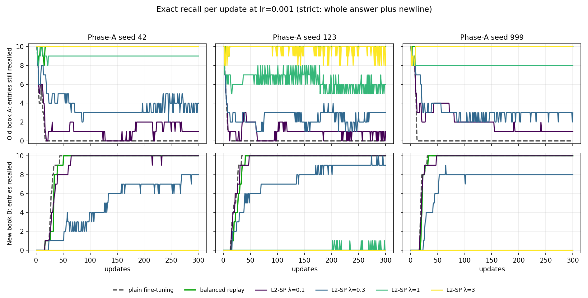
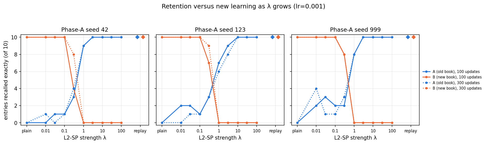
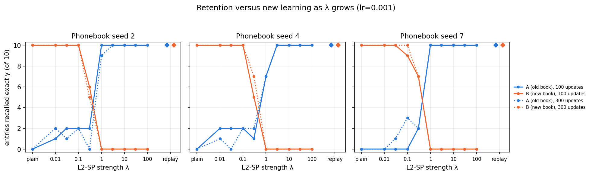
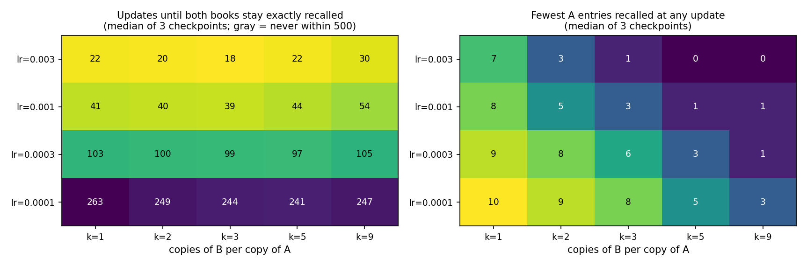

# Phonebook forgetting: what the experiments show

*Status as of Tuesday November 3, 2026. Protocol, per-experiment results and audits:
[`experiments/week_2026-10-07/README.md`](experiments/week_2026-10-07/README.md) (E1 to E3) and
[`experiments/week_2026-10-31/README.md`](experiments/week_2026-10-31/README.md) (E4 capacity, E5 replay ratio).
Derived tables and figures: [`results/`](results/).*

## The question

A small transformer (64 dimensions, 2 layers, 2 attention heads, 110,528 parameters) memorizes the
phone numbers of one phonebook (phase A, ten entries) and is then adapted to a second one (phase B,
ten entries). Plain adaptation forgets the first book. Two remedies are compared: **balanced
replay** (keep training on A while learning B) and **L2-SP** (penalize drifting from the phase-A
weights; needs no old data). A second question comes from the course README: if the replay data
holds one copy of A and k copies of B, which k reaches 100% on all the data fastest? A third
comes from the same README: what is the capacity of a very small model, that is, how many entries can it
memorize before 100% exact recall becomes impossible?

An entry counts as *recalled* only if greedy generation from its name produces the whole phone
number and the newline, with no length hint. Counts are entries recalled out of ten per book.

## Findings

1. **Replay learns both books.** At the trainer's default learning rate (0.001), balanced replay
   recalls 10 of 10 entries of A and of B after 100 and after 300 updates on all three phase-A
   checkpoints of the original phonebook (E1) and on three new phonebooks (E2). Both books are
   first recalled together at update 33 to 51 (E1) and 36 to 48 (E2), after A
   dips to 8 to 9 of 10. Plain fine-tuning ends with B at 10 and A at 0: B is first complete
   at update 31 to 44 and A is down to 0 by update 12 to 19.
2. **No L2-SP strength matches replay.** On the original phonebook (E1, nine strengths from
   λ = 0.01 to 100), on a finer grid trained for 1000 updates (E1b) and on the new phonebooks
   (E2), the pre-registered rule (one λ with A = 10 and B = 10, or A ≥ 9 and B = 10, on at least two
   of three checkpoints) gives "no" every time. L2-SP trades one book for the other along λ, with
   the change between λ = 0.3 and λ = 1: whenever a run kept at least 8 of A's entries it recalled 0
   of B's, and whenever it recalled at least 8 of B's it kept at most 4 of A's.
3. **Repeating B (the README's question).** With one copy of A and k copies of B, the smallest median
   time to joint recall is at k = 3 for lr = 0.003 and 0.001 and at k = 5 for lr = 0.0003 and
   0.0001, so in the medians k > 1 is faster at every learning rate, but only by 2 to 22 updates (5% to 18%): the
   choice among k = 2, 3, 5 is not resolved, and k = 9 is not faster. The temporary dip in A deepens
   with k (at lr = 0.001 the median fewest A entries recalled is 8, 5, 3, 1, 1 for
   k = 1, 2, 3, 5, 9). The learning rate matters far more than k.
   **E5 then repeated this on six independent phonebooks with a measured noise band of 0.** At lr = 0.001 the
   median time to joint recall is 40.0, 38.5, 38.5, 40.5, 44.0, 54.0 updates for k = 1, 2, 3, 4, 5, 9. By the
   pre-registered rule (which is a sign rule when the noise band is 0) only k = 2 beats k = 1: faster in 5 of 6
   phonebooks, by a median of 1.5 updates (about 4%). k = 3 ties it in the median, k = 4 and k = 5 are slower,
   k = 9 is 15 updates slower, the dip in A deepens monotonically (9, 6.5, 4, 3, 2, 0.5 entries kept), and k = 1 is
   by far the cheapest in sequences processed (800 against 1155 for k = 2).
4. **Counts in the regime-change region are noisy by about one entry.** Two runs that differ only
   in how often accuracy is logged have different shuffle orders of the training batch, and exact
   counts at the same update differ by one entry at about one in five updates there, rarely more.
   This failed a pre-registered cross-check (E1b against E1); its cause was then tested (d1).
5. **Capacity (the README's other question).** A 2-layer, 2-head model trained from scratch memorizes, within 1000
   epochs at lr = 0.001 and with the exact-recall criterion, 14, 113, 226 and 453 random name-to-number entries at
   widths 8, 16, 32 and 64 (3,064 to 110,656 parameters), which is 0.13 to 0.40 bits per parameter, far below one bit.
   The limit is mostly training time, not room: the first full recall of 10 entries comes at epoch 470 to 790, 200 to 220,
   110 to 120 and 60 to 70 for the four widths, the capacity at 500 epochs is smaller than at 1000 for three of the four, and
   the narrow models were still improving at epoch 1000. The wide models' next rung up flattened at 96% to 99% of its
   entries. No control entry was ever recalled. This is a capacity at a budget, not an asymptotic capacity.

## Claims and evidence

| # | Claim | Status | Evidence |
|---|---|---|---|
| 1 | At lr = 0.001, balanced replay recalls both books exactly at 100 and 300 updates | Established on this task, replicated on 3 new phonebooks | [`e1_endpoints.csv`](results/e1_endpoints.csv), [`e2_endpoints.csv`](results/e2_endpoints.csv) |
| 2 | Plain fine-tuning at lr = 0.001 ends with B 10 of 10 and A 0 of 10 | Established, replicated | same files; timing in the experiment README |
| 3 | No tested L2-SP strength matches replay at lr = 0.001 | Established for isotropic L2-SP: λ from 0.01 to 100 at 100 and 300 updates, and λ from 0.3 to 1 also at 1000 | [`e1_decision.json`](results/e1_decision.json), [`e1b_decision.json`](results/e1b_decision.json), [`e2_decision.json`](results/e2_decision.json) |
| 4 | L2-SP shows a trade-off with no λ that keeps A and learns B (A ≥ 8 implies B = 0; B ≥ 8 implies A ≤ 4) | Established on these runs | [`e1b_fine_grid.png`](results/e1b_fine_grid.png), [`e2_dose_response.png`](results/e2_dose_response.png) |
| 5 | k > 1 reaches joint recall slightly sooner than k = 1 at every learning rate; k = 9 does not | Observed in the medians at every learning rate; small; run-to-run timing noise not measured; the paired sign tests are exploratory | [`e3_table.csv`](results/e3_table.csv), [`e3_cells.csv`](results/e3_cells.csv) |
| 6 | Any particular k among 2, 3, 5 is best | **Not established in E3; E5 narrows it**: k = 2 and k = 3 tie in the median (38.5), k = 2 is faster than k = 1 in more single runs (15 of 18 against 10 of 18), k = 5 is slower | [`e3_heatmaps.png`](results/e3_heatmaps.png), [`e5_analysis.json`](results/e5_analysis.json) |
| 7 | Counts near the L2-SP regime change carry about one entry of numerical noise | Measured in E1b against E1; d1 shows the logging interval alone changes the trajectory. For replay timing at lr = 0.001, E5 found no variation at all under five other shuffle seeds (noise band 0) | [`d1_logging_interval/`](experiments/week_2026-10-07/d1_logging_interval/), [`e5_analysis.json`](results/e5_analysis.json) |
| 8 | L2-SP is the more promising direction; replay's trade-off is binary | **Retracted** (see below) | [`sweep_lr/README.md`](sweep_lr/README.md) Parts 9 and 10 |
| 9 | Other regularizers (EWC), other model sizes for the replay question, larger or other kinds of data | **Not tested** | |
| 10 | At lr = 0.001, k = 2 reaches joint recall slightly sooner than k = 1 (about 1.5 updates, 5 of 6 phonebooks); no other k does; k = 9 is much slower | Established by the pre-registered rule on six phonebooks (E5); small, and the rule is a sign rule because the noise band is 0 | [`e5_analysis.json`](results/e5_analysis.json), [`e5_cells.csv`](results/e5_cells.csv), [`e5_prediction_scores.json`](results/e5_prediction_scores.json) |
| 11 | A 2-layer, 2-head model memorizes 14, 113, 226 and 453 random entries at widths 8, 16, 32, 64 within 1000 epochs | Established for this budget, learning rate and exact-recall criterion, with three book seeds per rung | [`e4_capacity.json`](results/e4_capacity.json), [`e4_cells.csv`](results/e4_cells.csv), [`e4_prediction_scores.json`](results/e4_prediction_scores.json) |
| 12 | Capacity is limited by training time more than by parameter count | Supported (narrow models still improving, boundaries moving, 0.13 to 0.40 bits per parameter); not tested with more epochs | same files |
| 13 | Capacity is an asymptotic property of the model | **Not established**: only 1000 epochs, constant lr 0.001; the next rung up reached 70% to 99% of its entries | |

## What was retracted

The September 29 synthesis (sweep README Parts 8 and 9) concluded that replay learns none of book
B while L2-SP's partial learning of B made L2-SP the direction to pursue. On October 4 an audit found
that it compared L2-SP's B *token* accuracy with replay's B *exact* recall, and that replay had
been run at lr = 0.0001 for 100 updates, which is too little for B (Part 10). This week's
experiments tested the question properly: at lr = 0.001 replay recalls both books and no L2-SP
strength does (findings 1 and 2).

## Figures










## Limits

- One task type (20 random names and phone numbers, ten entries per book), one model size, one
  optimizer setting apart from the learning rate; counts move in tenths, so a one-entry difference
  is small.
- Three Phase-A checkpoints of one phonebook (E1, E1b, E3) and three new phonebooks (E2), one
  shuffle stream per run. Medians in E3 are over three checkpoints. E5 adds six independent phonebooks
  (the unit of replication, three Phase-A inits each) and measured the shuffle noise (0). E4 uses three book seeds per rung.
- L2-SP here is the isotropic penalty from the mitigation notes. A "no" is not a claim about every
  regularizer; a Fisher-weighted penalty (EWC) was not tried.
- E3 counts updates, not work: at k = 5 each update processes 60 sequences against 20 at k = 1. E5 reports both.
- Capacity is read at 1000 epochs with a constant learning rate and an exact-recall criterion; the ladders step by about
  1.4x, so a capacity is known only to the nearest rung, and several rest on a cell finishing at the edge of a budget. It is a lower bound:
  the rung above each capacity was only seen not to reach 100% in 1000 epochs. E4 varies only the width (2 layers and 2 heads throughout),
  and sets it on the trainer command line, leaving `phonebook/config/phonebook.py` at its defaults.
- Replay uses old data and L2-SP does not, so "replay wins" says nothing about the case where old
  data are unavailable, only that isotropic L2-SP does not rescue it here.

## Next steps (candidates, not promises)

1. A Fisher-weighted penalty (EWC), and replay of only a fraction of A, to see what is needed
   when old data are limited.
2. Capacity beyond 1000 epochs and with a learning-rate schedule, and for other shapes (layers, heads): do the
   narrow models' next rungs complete, and what stops the wide models at 96% to 99%?
3. Other kinds of data than random phone numbers.

## Checking this

Every experiment is a committed spec in [`specs/`](specs/) with predictions or rules fixed before
the runs, and a separate audit script (code written apart from the runner, not a third party) covered every run:
579 training runs and 26,862 generated answers, all consistent (the 420 runs of the week of November 3 are in
[`experiments/week_2026-10-31/`](experiments/week_2026-10-31/README.md); one of those audits failed at PyTorch's default
thread count on a 1.4e-6 relative loss difference and passes at the training thread count, as that README explains).
From a fresh clone, the committed files alone can be re-audited (run from the repository root):

```bash
python phonebook/audit_experiment.py --root phonebook/experiments/week_2026-10-07/e3_replay_ratio
```

This reconciles the manifest, protocol, the spec at its recorded commit, the summaries, the logged
metrics and the saved raw answers (each re-scored from the strings). The model weights are not
committed; with them in place, `--require-local-artifacts` also re-generates every answer from the
saved weights, which is how the audits recorded in each folder were run. One pre-registered check
failed, E1b against E1; it is reported as failed in the experiment README with its tested cause
(d1).

## AI assistance

Claude Code assisted with the code, experiments, audit and writing. The predictions for E4 and E5 were drafted by
Claude at the researcher's request and confirmed by the researcher before any run (see the November 3 experiment README).
