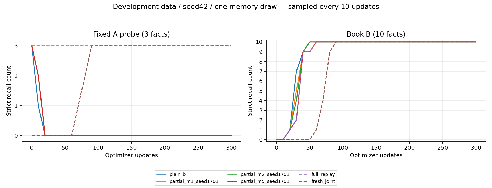

# Partial replay: execution, review, and stop decision

This follow-up began October 20 and continued October 21, 2026, America/New_York. Training itself ran **October 20, 23:51:13–23:56:34 EDT** (03:51:13–03:56:34 UTC October 21). Later audits, documentation, and final tests belong to October 21. The containing folder retains the original review's date; it is not evidence that every file was completed before midnight. The October 12–20 retrospective still contains no invented October 12–19 activity.

## Outcome and next action

The six-condition development pilot is complete. At the common **300 optimizer updates**, each partial replay condition recalls its replayed facts and **zero unreplayed facts**, while B is 10/10. Full replay and fresh joint both recall A and B completely. The proposed direction that m=5 would improve fixed-probe recall over m=1 was **not observed in development**.

| Condition | Replayed A | Unreplayed A | Fixed A probe | B | Training sequences at 300 updates |
|---|---:|---:|---:|---:|---:|
| B only | N/A | 0/10 | 0/3 | 10/10 | 3,000 |
| Partial m=1 | 1/1 | 0/9 | 0/3 | 10/10 | 3,300 |
| Partial m=2 | 2/2 | 0/8 | 0/3 | 10/10 | 3,600 |
| Partial m=5 | 5/5 | 0/5 | 0/3 | 10/10 | 4,500 |
| Full replay | 10/10 | N/A | 3/3, exposed | 10/10 | 6,000 |
| Fresh joint | 10/10 | N/A | 3/3, exposed | 10/10 | 6,000 |

Full/joint probe facts enter their training; these are positive controls. Partial probe facts enter evaluation/analyst diagnostics but never the adaptation loss. Every A fact was already available in Phase A.

The separate 6,000-sequence endpoint uses 600/545/500/400/300/300 updates respectively. The m=1 condition uses 5,995 sequences; all others use 6,000. This analysis changes the number of AdamW updates and decay applications. It cannot isolate memory size from optimizer work. All endpoint counts, CE, sampled curves, and observations are in [the rebuilt results](partial-replay-results-v2/summary.json), [18 endpoint rows](partial-replay-results-v2/endpoints.csv), and [sampled observations](partial-replay-results-v2/sampled-observations.csv).



**Decision:** stop before generating confirmation data or launching the tentative 90-run matrix. The engineering gates support this development result; they do not make its question novel or its single dataset conclusive. Use [the professor discussion packet](../professor-discussion-packet.md) to decide whether this negative observation warrants replication or whether a stronger question should replace the provisional direction. Keep all six conditions, including the negative results. Do not search a larger grid until a preferred outcome appears.

## Implementation and predeclared execution

[run_partial_replay.py](../../run_partial_replay.py) is a separate development CLI. The historical `run_replay_pilot.py` and its three tests retain their original bytes and behavior. The new runner:

- Checks the external membership pin, source books, exact common vocabulary, explicit checkpoint architecture including head count, finite float32 tensors, initial checkpoint/meta pins, numeric settings, and primary/sequence-budget compatibility before creating an unused output root.
- Encodes precisely the declared unique training rows, verifies binary bytes, and compares every row's padding/target mask with `SequenceDataset`. One ordered full batch equals one optimizer step; no shuffle or inherited optimizer state is used.
- Uses the shared [weighted-token objective](../../../completion_core/objectives.py). B only minimizes token-mean B CE; nonempty replay/joint minimizes `0.5 * token-mean A_subset CE + 0.5 * token-mean B CE`. AdamW uses lr=.001, decay=.1, betas=(.9,.999), eps=1e-8, clipping norm=1, and fresh moments; L2-SP is off.
- Requires initial adapted checkpoints to recall all ten A facts before updates. Fresh joint uses seed42 initialization. All conditions use context29, vocabulary67, d_model64, two heads, and two layers: 110,528 parameters.
- Saves integer work, every update's pre-update objective/gradient norm, training/evaluation/diagnostic time separately, raw answers and teacher statistics every ten updates plus endpoints, and checkpoints at zero/100/300/sequence-budget endpoints. The recipe contains exact effective settings, argv/environment, source hashes and copied source bytes, initialization bytes/pins, and condition membership. There are **2,645 training updates and 35,995 sequences** in the six runs, not six independent datasets.
- Reports parameter and optimizer **tensor** bytes, retained old record counts/UTF-8 bytes, and zero L2-SP anchor bytes separately. These are not peak process RAM, total system storage, or a claim that the analyst retains only m facts.

Runtime measurements were collected while the regression suite ran on the same machine. Treat these elapsed times as execution records, not a fair ranking of condition speed. Use the exact update/sequence/token counts for the work comparison. Independent processes and CPU contention do not invalidate the reproduced parameter trajectory.

The development specification was written before the first optimizer step. Its canonical pin is `d54a941e5cd794e590eadfc197395e55d4954988fdf5b030d8787f2af911d2f3`; membership pin is `8bd47398f7ea33564e646dbcf04e6e9c84aa6344bf778a642b2b9f4b8093bd30`. The output root is `phonebook/experiments/partial_replay_development_v1`. This uses a **dirty development tree with frozen source-byte snapshots**, explicitly recorded as such. It is not the clean committed spec required before confirmation. Checkpoints and prepared binaries remain ignored local artifacts.

The [artifact manifest](partial-replay-results-v2/artifact-manifest.json) seals every file in the pilot root, including new checkpoint bytes and command/environment records. Its external canonical pin is `7552d5fd34ca9e52497b52f310d19c683720b1a8fb7a78a8f6ddc0f424256720`. A manifest and pin co-edited by an untrusted author cannot authenticate historical execution. The reproducible recipe and external evidence pins address different questions.

## Numerical and theoretical review

The shared weighted objective still passes the original float64 proof/gradient matrix. The [additional float32 check](partial-optimizer-verification.json), generated by [this script](verify_partial_optimizer.py), checks all **174 parameter-gradient tensors** across the six production-model conditions against separately computed book means. Both implementations also pass an independent first-step AdamW formula check for every parameter.

The first test attempt incorrectly demanded near-identical float32 parameter updates between separate-batch book means and one weighted batch. Two cases failed despite close losses and every gradient. Those failures remain in [the first log](pilot-tests-initial.txt) and [the distinct-name rerun](partial-tests-first.txt). The corrected test verifies each optimizer calculation against its analytic first-step formula; it does not widen an equivalence tolerance and declare the two trajectories equal. In the production-model one-step check, the maximum cross-implementation parameter gap is **0.000283432**, and the maximum logit gap on that case's training rows is **0.000024319**. Tiny gradients near mathematically zero attention-key biases can be amplified by AdamW's epsilon. Parameter differences alone do not establish meaningful functional or long-trajectory divergence.

Isolated diagnostics at updates **1, 100, 300** measure the actual AdamW displacement and compute `g_probe^T delta` and `0.5 delta^T H_probe delta`. Diagnostics use a copied model and the math attention backend to obtain second derivatives. They do not feed information into training. Tests verify unchanged weights, gradients, optimizer state, model mode, and CPU RNG after diagnostics/evaluation. The deterministic training replay provides an additional trajectory check.

For B only at update1, probe CE increases by **0.00981298**. The linear term is **0.00098230**, the quadratic term **0.00604064**, and the second-order residual **0.00279004**. The second-order approximation captures more of this local change, but still underestimates it by about 28%. This is a limited diagnostic example, not a causal mechanism, accuracy guarantee, or proof of permanent forgetting. All 18 diagnostic records, including residuals and controls, remain in their run JSON files.

## Validation and remaining limits

The first full regression run passed **610 tests in 404.14s**. Subsequent reporting/sealing checks passed all **32 focused tests**, including three added report checks. Disposable mutation tests cover predictions, subset IDs, initialization identity, optimizer metrics, work summaries, missing final updates, binaries, checkpoint parameters, optimizer state, diagnostics, source snapshots, and the externally pinned spec. Tests also cover unused-output protections, invalid numeric settings/budgets, semantic head mismatch, explicit binary masks/order, and state isolation. See [the focused log](partial-tests-report.txt) and [first full log](partial-tests-full.txt). The final expanded suite and delivery reconciliation are recorded below. A subsequent plot regression also checks panel sizes, the common horizon, and the declared sampling interval on the tiny fixture; these values are derived from the protocol rather than assumed to be 3/10/300/10. The first report version remains preserved, and version 2 adds explicit sampling metadata.

Readable run auditing reconciles raw partition records, work, binary/text membership, initialization intent and endpoint fresh inference. Full auditing deterministically re-executes every optimizer step, compares every saved endpoint tensor and final optimizer state, every logged objective/norm, every sampled evaluation, and all diagnostics. It verifies the saved local recipe; it is not signed evidence of who executed it. Standalone `evaluate_replay.py` continues to mark `training_execution_verified:false`; training reproducibility is a separate runner audit and must not be inferred from that standalone flag.

All seven historical experiment roots again pass readable and full-local audits: **159 runs and 3,180 fresh answers** in [the records](partial-historical-audits.json). The preservation/rebuild checks and final expanded suite are recorded in the final delivery verification linked below. General onboarding findings about reverse/addition evaluation, legacy direct-adaptation metadata, unpinned dependencies, and CI remain listed in [the original source review](source-review.csv). This pilot does not exercise those paths.

During implementation, a filename collision briefly replaced the old pilot and test paths. Both were restored to the exact prior recorded SHA-256 before the real run; the new implementation uses distinct filenames. No historical experiment data were overwritten. The initial failure logs remain evidence of the development process.

## Reproduction

Set `OMP_NUM_THREADS=1`, `MKL_NUM_THREADS=1`, and `MPLBACKEND=Agg`. The CLI sets one PyTorch CPU thread. From the repository root:

```powershell
python -m pytest -q
python phonebook/run_partial_replay.py audit --root phonebook/experiments/partial_replay_development_v1 --specification-sha256 d54a941e5cd794e590eadfc197395e55d4954988fdf5b030d8787f2af911d2f3 --replay-training
python phonebook/report_partial_replay.py --root phonebook/experiments/partial_replay_development_v1 --specification-sha256 d54a941e5cd794e590eadfc197395e55d4954988fdf5b030d8787f2af911d2f3 --out-root NEW_REPORT_DIRECTORY
```

To repeat training, use the exact command in [the execution receipt](../../experiments/partial_replay_development_v1/execution.json) with a new output root. Ignored local weights, binaries and metadata are required for full-local audits. The source-only fixture tests do not require historical ignored artifacts. The final review links below distinguish reproducible checks from research inference; no finite suite establishes 100% correctness or novelty.

## Final acceptance, October 21

The final full suite passes **614 tests in 310.07s**, with zero failures, errors, or skipped tests: [text log](partial-tests-accepted.txt), [JUnit record](partial-tests-accepted.xml). This includes the plot regression added after the earlier 613-test pass. No production source changed after these accepted checks.

The [full training replay log](partial-pilot-replay-audit.txt) reproduces all 2,645 optimizer updates, 22 endpoint checkpoints, six final optimizer states, 271 sampled evaluations (5,420 raw answers), and 18 diagnostics. The [delivery reconciliation script](verify_partial_delivery_final.py) checks the external 337-file artifact seal, all 1,337 historical artifacts, the 58 prior Python files intentionally left unchanged, seven historical local audits, and byte-identical rebuilt tables/figure. The only changed file among the prior 59 Python files is the numerical verifier, which now imports the production objective and includes it in its source hashes. All new sources are identified separately.

The implementation, pilot, code review, and engineering acceptance gates are complete. The professor conversation, question/novelty review, and clean committed confirmation protocol remain outstanding. The provisional 90-run matrix was not executed. Changes remain local and uncommitted.

Final machine-readable acceptance: [delivery verification](partial-delivery-final-verification.json), [verification output](partial-delivery-final-output.txt). These records include exact source/evidence hashes and the confirmed preservation/rebuild counts.
