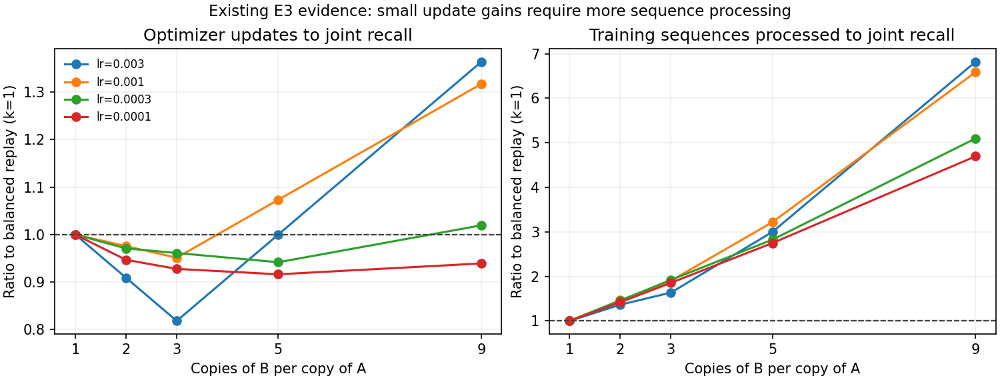

# Research plan and evidence review: October 12–20, 2026

Prepared October 20, 2026, America/New_York. Requested scope: a retrospective plan for October 12–20, rather than a schedule for the following week. Codex assisted with this review and document.

**Earlier engineering status, October 20 (before the development pilot):** the large experiment matrix below remains provisional. It specifies a fixed unreplayed evaluation panel and separate common-update and work-budget analyses. Completed engineering gates include RNG isolation with a legacy mode, initialization declaration/pin/context reconciliation, finite numeric validation, and token-weighted epoch loss reporting. The actual phonebook model has identical weights at every one of 100 updates across logging intervals 1/5/10 under isolated RNGs.

The full-batch objective gate passes **81 float64 comparisons**, checking literal duplication, fixed book mass, every parameter gradient, and the analytic L2-SP derivative. The subsequent membership/measurement gate adds pinned replay/probe declarations, exact prepared-text checks, partitioned scores, and readable/fresh-inference audits. That membership gate passed **581 tests**. All 59 pre-existing Python files and 1,337 original artifacts remained unchanged during that gate. The latest historical full-local audit remains the successful seven-root, 159-record, 3,180-answer validation; its dependencies remain unchanged.

Subsequent execution on October 20–21 completed a separate weighted training runner, exact binary/common-vocabulary checks, source/initialization/command receipts, actual-work logging, float32 checks, a self-contained workflow, and the six-condition development pilot. The accepted full suite passes 614 tests. At the common 300-update endpoint, each partial memory retains its replayed entries but recalls zero unreplayed entries; full replay and fresh joint both reach A10/10 and B10/10. See the [execution and review record](review-2026-10-20/partial-replay-execution.md) and [professor discussion packet](professor-discussion-packet.md). The tentative confirmation design remains unlocked; no confirmation data or runs have been generated. Standalone partition reports retain their deliberately limited training-verification flag, while the separate runner audit can reproduce the recorded optimizer recipe. See [the RNG record](review-2026-10-20/second-review.md), [initialization-audit record](review-2026-10-20/initialization-audit-fix.md), [numeric/loss record](review-2026-10-20/finite-loss-fix.md), [weighted-objective record](review-2026-10-20/weighted-objective-review.md), and [membership record](review-2026-10-20/replay-membership-review.md). The [derivation](weighted-objective-analysis.md) distinguishes objective normalization from physical work; section 2 retains the initial audit snapshot.

**Recommendation:** use the professor meeting to choose one causal research question: **how much old-data memory is needed to protect facts that are never replayed, after controlling objective weighting and training work?** The measurement, derivation, and development gates are now complete. Discuss the negative development result before deciding whether to lock that replication or choose a stronger direction. Another broad learning-rate or L2-SP sweep is a lower priority.

This is a proposed work sequence for the requested window, reconstructed today. It is **not an account of work performed on those past dates**. The repository's latest commit is `8b4ccf34ca6351f7914596e8138da3a358cce1db`, dated October 11. The available Git history contains no October 12–20 commits; the 167 experiment-manifest records under `phonebook/experiments/` contain no training timestamps in that window. Work outside this repository, meetings, attendance, submissions, and your personal hours are unverified. The checks in this document were run during the October 20 review.

## 1. What the professor's feedback calls for

The professor already recognizes participation and experimental progress. The next improvement is a research argument that can withstand inspection: an accessible repository, a specific unanswered question, a controlled experiment, and an explanation of why the outcome occurs.

The [repository](https://github.com/hmhngx/comp560_harrison_nguyen) is public, confirmed through GitHub during this review. Give the professor an entry point directly to the [published results summary](https://github.com/hmhngx/comp560_harrison_nguyen/blob/7bef2eb4fb2abe026af98da8d7d716381d6c9770/phonebook/RESULTS.md) and [published experiment protocol and results](https://github.com/hmhngx/comp560_harrison_nguyen/blob/7bef2eb4fb2abe026af98da8d7d716381d6c9770/phonebook/experiments/week_2026-10-07/README.md). GitHub's `main` points to `7bef2eb`; the local checkout is one commit ahead at `8b4ccf3`, which adds documentation precision. The links deliberately use the confirmed published revision. Publish the local documentation correction before asking the professor to review the final wording. This new plan and review package are also local additions until you publish them.

Bring three meeting questions:

1. Would a study of **retention of unreplayed random associations with limited replay memory** be a useful next investigation for this course?
2. Is a controlled empirical result plus a local gradient/curvature analysis sufficiently ambitious, or should the investigation instead manipulate similarity between old and new prompts?
3. Which single extension would make the result more interesting: more independent phonebooks, more task entries, or an importance-weighted regularizer?

Ask for a 20–30 minute discussion, bring a one-page result summary and the resource-accounting figure below, and leave with one question and one success criterion. Record what was actually discussed. This review did not send a message, schedule a meeting, or submit an activity log.

## 2. What is verified now

The full audit record is [review-2026-10-20/README.md](review-2026-10-20/README.md), with an [inventory of every scanned file](review-2026-10-20/file-inventory.csv).

| Check run October 20 | Result | What it establishes |
|---|---|---|
| Entire local tree, excluding `.git` internals | 1,446 files, 133,363,377 bytes; all 643 tracked files included | A recorded path, size, SHA-256, and type-specific check for every file at scan time |
| Python source and tests | All 52 files, 7,657 lines; syntax parsed and source reviewed | Coverage of the implementation, drivers, analysis, generators, and tests; not a proof of correctness |
| Full pytest suite | **302 passed in 256.87 seconds; no skips or reported warnings** | Existing regression and integration checks pass in this environment |
| Seven October 7 experiment evidence roots | Both readable and full-local audits pass: **159 training records and 3,180 freshly regenerated answers** | Saved scores, committed specs, inputs, local weights/data, and endpoint inference reconcile under the current auditor |
| October 4 evidence | Three full-local hash audits pass: 8 training records, 20 evaluations, 400 saved answers | Historical strings/counts and local hashes reconcile; that older auditor does not freshly generate the answers |
| Derived reports | All **12 CSV/JSON result files** independently rebuilt through the report pipeline and matched | The committed tables and decisions follow from the saved evidence |
| Ignored binary artifacts | 212 checkpoints, 46 vocabulary files, 92 token binaries checked | Weights load and are finite; vocabularies are bijective; binary token ranges and final newlines are valid |
| Figures | All 241 PNGs pass image-file integrity checks | Files decode; this is not a visual examination of every historical plot |

The inventory also parses all 225 JSON files, 11 JSONL files, 250 CSVs, and the existing XML file, and reads the remaining text, including the ten Markdown documents and 168 logs. `.pyc` files receive hashes only. The new resource-accounting figure was visually inspected. Cache files account for the increase from the initial 1,438-file inventory to 1,446 while the suite imported modules.

Testing used Python 3.12.10 and PyTorch 2.12.0+cpu, CPU execution, `OMP_NUM_THREADS=1`, `MKL_NUM_THREADS=1`, and `MPLBACKEND=Agg`. See the saved test log/XML and audit JSON for details. Model training was exercised by the integration suite; no proposed research study below was executed.

### Scientific conclusions that remain defensible

- On the tested ten-entry A/B books, balanced replay at lr=0.001 reaches exact recall of both books; plain fine-tuning learns B while losing A. E1 covers three Phase-A checkpoints of the original data; E2 adds three other phonebooks.
- The tested isotropic L2-SP settings fail the recorded criterion for matching replay. The broad grid reaches lambda=100 at 100/300 updates; only the finer lambda=0.3–1 grid reaches 1,000 updates. This is not a universal impossibility result for L2-SP or regularization.
- Repeating B can reduce the median number of updates slightly. It also processes more sequences and can produce a much deeper temporary loss of A recall.
- The logging interval changes the training shuffle stream in the current trainer. This is already documented by d1 and is directly reproduced by the October 20 RNG probe.
- These are arbitrary association memorization experiments. The extra phonebooks test replication across datasets of the same kind, not unseen-fact generalization or broad language-model behavior.

### A useful result available without new training

At lr=0.001, the E3 medians imply:

| B copies per A copy | Updates to sustained joint recall | Sequences per update | Sequences processed to that point | Minimum A recall, median |
|---|---:|---:|---:|---:|
| 1 | 41 | 20 | **820** | 8/10 |
| 2 | 40 | 30 | 1,200 | 5/10 |
| 3 | 39 | 40 | **1,560** | 3/10 |
| 5 | 44 | 60 | 2,640 | 1/10 |
| 9 | 54 | 100 | 5,400 | 1/10 |

Thus k=3 saves 2 updates, about 4.9%, while processing about 90.2% more sequences than k=1. Across the four learning rates, k=1 has the lowest median sequence-processing count among the tested ratios. This is a reanalysis of existing E3 data, not a new replication or a wall-clock speed measurement. The original results already acknowledge the work confound; this table quantifies it. Each phone number has 13 supervised targets, including newline, so supervised-token counts scale by 13. Padded input tokens, runtime, memory, and FLOPs are distinct costs.



## 3. Strict code-review findings and required gates

Priorities below indicate what blocked a dependable follow-up at the first review. The saved [probe results](review-2026-10-20/review-probes.json) document those reproduced cases. The second-review record tracks subsequent fixes separately; historical evidence remains unchanged.

| Priority | Finding and location | Consequence | Required change and acceptance test |
|---|---|---|---|
| P1 | Shared RNG in `train.py:198–206`; evaluation iterates DataLoaders | Accuracy logging changes subsequent training permutations; small timing differences cannot be treated as clean treatment effects | Give training and evaluation separate generators. Compare interval 1, 5, and 10 runs from identical initialization: identical train batch indices and final tensors in a fixed deterministic CPU environment. Repeat with more than one batch. Also test short-run/long-run prefix equality. |
| P1 before a limited-memory claim | Current metrics mix all A records together, and the runner only supports whole-book copies | Partial replay could look successful because only the replayed subset was retained | Add immutable subset IDs and report A-replayed, A-unreplayed, A-all, and B separately; reject overlaps/duplicate prompts. Verify subset counts sum to A-all and every retained sample appears in the manifest. |
| P1 for provenance claims based on readable evidence | `audit_experiment.py:157–188,249–253` does not reconcile stored initialization hashes with the spec's pinned hashes in the default audit | A copied E1-prefix protocol with its initialization hash changed to 64 zeros still passes the readable audit, despite an unchanged committed spec containing a different pin | Reconcile initialization scenario coverage, paths, metadata, and any hash pins with the committed spec before optional local checks. Mutate each field individually and require rejection with `check_git=True`. Untouched historical evidence must continue to pass. |
| P2 | `_is_number` and comparisons in `run_experiment.py:56,124–133`, and CLI validation in `train.py:139–153`, accept NaN/Infinity | The spec accepts nonfinite lr/lambda. Direct CLI lambda=NaN reaches config and the `>0` check disables the penalty silently | Require finite numbers at every entry point, valid integer sizes/budgets, and positive lr. Reject nonstandard JSON NaN/Infinity and serialize with `allow_nan=False`. Test direct CLI, config-file values, and specs before output creation. |
| P2 before scaling | Both loss reducers in `completion_core/training.py:141–143,166,183` average batch means equally | Reported dataset loss is wrong when batch token totals differ. Probe: 5.000046 reported versus 3.333379 over the actual supervised tokens | Accumulate summed task loss and supervised-token count for evaluation. Clearly define training loss as the online loss of the changing model. Test an unequal last batch and variable output lengths; keep the gradient objective explicit. Current one-batch phonebook comparisons are unaffected by this averaging issue. |
| P2 before arbitrary phonebooks/capacity studies | `train.py:192` sizes the context from the training book; adaptation loads only state tensors | Longer evaluation records or a shorter adaptation corpus can break context compatibility. A same-shaped checkpoint with a different head count or token ordering can be semantically incompatible without a shape error | Validate context, architecture metadata, and vocabulary identity before adaptation; introduce a declared common context if generalizing beyond the current equal-longest-line design. Test a longer eval book and a same-size permuted vocabulary. Preserve the historical default for historical reproduction. |
| P2 for claims outside phonebooks | `generate_reverse.py:23,38–52` never populates `trained_sequences` or reads `--train-file` | The output labeled "Unseen Evaluated" includes training examples | Read and normalize the declared training prompts, subtract them from the evaluation domain, and test the reported denominator with an overlapping fixture. |
| P2 for claims outside phonebooks | `generate_all.py:51–56` and `generate_all_additions.py:51–56` compare cleaned strings using target-dependent budgets | Their success criterion is weaker than strict phonebook evaluation: missing newline or generated padding can be hidden by the compatibility string interface | Use structured completion results and exact token-plus-newline matching with a context-based budget. Test malformed suffixes, padding, context stops, and missing newline. Keep exhaustive-domain accuracy separate from train-excluded accuracy. |

Additional review points:

- `requirements.txt` is unpinned and has no Python minimum, despite Python 3.12 generic-function syntax in `completion_core/prep.py`. Record a reproducible tested environment and the Python requirement. Historical protocols already record direct package versions.
- There is no tracked CI configuration. Add clean-checkout CPU tests; explicitly account for the real-phonebook integration test's dependency on ignored artifacts. A green run with that test skipped is different evidence from today's no-skip run.
- The old sweep driver's completion check only uses the final CSV epoch and its checkpoint tag only uses the parent directory's name. Use the declarative experiment runner for new studies; do not expand the legacy driver's assurances into proof of artifact identity or completeness.
- Four-decimal accuracy logs are adequate for these small denominators, but integer counts should be persisted directly before larger-task analysis. Epochs must also stop standing in for optimizer updates when there is more than one batch.
- Historical prose saying shuffle order or Phase-B seeds cannot affect results is too absolute; later d1 supersedes that reasoning. Add a dated correction near old claims rather than modifying historical data.
- The root addition generator samples with replacement. 3,000 draws do not guarantee 3,000 unique pairs or 30% domain coverage; a global exhaustive accuracy is not a train-excluded generalization score. This is a separate onboarding-documentation issue, not a defect in the phonebook replication.

These findings do not imply the original experiment artifacts are corrupt. The existing full-local audits pass. They limit which stronger conclusions and future experiments the current code can support.

## 4. Theoretical deliverable: explain what is actually optimized

Prepare a two-page derivation that you can reproduce on a whiteboard. The equations below are proposed analysis, not newly established empirical findings.

### A. Repetition is objective weighting in a full batch

Let `L_A` and `L_B` be mean supervised-token cross-entropies of the two books. Here each book has ten entries and each entry has 13 output targets. One full batch containing A once and B k times therefore has exactly the objective

`L_k(theta) = (L_A(theta) + k L_B(theta)) / (1 + k)`.

Identical repeated rows supply no new independent facts. In exact arithmetic their gradients can be computed once on the unique A+B rows with weights `1/(1+k)` and `k/(1+k)`. A weighted implementation can avoid redundant forward/backward computation while preserving the mathematical objective. Validate scalar losses and **every parameter gradient** in float64 first; floating-point reduction order means an AdamW trajectory need not be bit-identical to literal duplication.

For unequal supervised-token totals `T_A,T_B`, the correct expression is `(T_A L_A + k T_B L_B)/(T_A+k T_B)`. Book-balanced weighting is a separate objective and must be named explicitly. The full-batch identity does not imply equivalence to repeated SGD/Adam steps on minibatches.

This yields a falsifiable control: compare literal duplication with explicitly weighted unique records at identical optimizer settings. If loss/gradient checks fail, stop. If long trajectories diverge despite close one-step checks, report numerical sensitivity rather than silently declaring them identical.

### B. Retention depends on direction, not just distance

For an actual parameter update `delta`, a local expansion is

`L_A(theta + delta) - L_A(theta) ≈ g_A^T delta + 0.5 delta^T H_A delta`.

Under plain SGD on B, the first-order term is `-eta g_A^T g_B`. Under this repository's AdamW, measure the **actual update delta**, including optimizer preconditioning, clipping, and decay; raw gradient cosine alone is not the update's predicted effect. Near a well-fitted A solution the first-order term can be small, making curvature relevant.

L2-SP penalizes squared Euclidean distance to the anchor. It does not know which directions preserve a particular fact. In a local quadratic approximation to B, and when the inverse exists, the stationary displacement is `delta* = -(H_B + 2 lambda I)^(-1) g_B`. The factor 2 follows from this code's `lambda * sum(delta_i**2)` convention. This is a local model, not a convergence guarantee for the nonlinear network.

For partial replay, compare the replay-subset gradient with the loss change on **unreplayed** A entries. Predeclare a small number of diagnostic updates, use an isolated diagnostic model/RNG, and confirm diagnostics do not change training weights, gradients, optimizer state, or ordering. These measurements use the analyst's evaluation access to full A; the training method still receives only its declared subset.

### C. Place the proposal in existing work

L2-SP's reference-to-initial-weights penalty is established in [Li, Grandvalet and Davoine, 2018](https://proceedings.mlr.press/v80/li18a.html). Importance-weighted quadratic protection is established in [Kirkpatrick et al., 2017](https://doi.org/10.1073/pnas.1611835114). Small replay memories have also been studied extensively, including [Chaudhry et al., 2019](https://arxiv.org/abs/1902.10486).

Consequently, neither adding replay weights nor implementing EWC is itself a new research contribution. The candidate contribution here is a carefully controlled result about unreplayed arbitrary associations, objective weighting, work, and local interference in this micro-transformer. Its novelty remains a professor/literature question. These three papers establish background, not an exhaustive novelty search.

## 5. One bounded investigation, with explicit stopping rules

**Main question:** with a fixed replay loss weight, how does the number of distinct old facts available during adaptation affect retention of the old facts that are never replayed?

**Candidate directional hypothesis:** at 300 optimizer updates, a five-record replay memory will preserve more recall on a fixed three-entry A probe panel than a one-record memory, while B reaches at least 9/10. This is a proposed hypothesis for discussion, not an established effect or a claim that three probe entries can resolve small differences. Report the A and B outcomes even when the joint criterion fails. No threshold memory size or global optimum can be inferred from this coarse grid.

**Development gate:** after the RNG and provenance gates, use the original phonebook and seed42 only to debug, validate weighting, and estimate runtime. The first research pilot is at most six conditions: plain B, partial replay m=1/2/5 using one subset draw, full replay, and fresh joint A+B. Use lr=0.001 from the existing evidence rather than opening another large tuning grid. Do not count development outcomes as independent confirmation. Record any redesign after seeing the pilot; do not generate confirmation data or launch a large grid until the question, metrics, and feasibility have survived that review.

**Tentative confirmation design, to lock only after the pilot and professor discussion:**

- Generate three new datasets with the existing generator. Before any model training, select the first three qualifying seeds starting at 100 using only the documented equal-longest-line condition. Record attempted seeds and lengths; do not select on learning results. The restricted data distribution is an explicit limitation. A common fixed context is a later alternative if this restriction matters scientifically.
- Train Phase A independently with seeds 42, 123, and 999 for each dataset: **9 Phase-A runs**. Require strict 10/10 A recall. Predeclare fresh 200/400-update attempts if the 100-update gate fails; preserve all attempts. Stop the study for review if a checkpoint still fails rather than silently replacing it.
- For each of those nine starting points: plain B-only adaptation, full replay, and replay of **m=1,2,5** distinct A records with two fixed subset draws each. Add a fresh joint A+B control for each dataset/initialization seed. This is **81 Phase-B/control runs**, or **90 training runs** including Phase A before any gate extensions.
- Before training, select a fixed three-entry A probe panel using seed 1733 and the declared `sha256-rank-v1` permutation, separately from the memory draws. The remaining seven A entries form the candidate replay pool. Every partial-memory condition and plain B are evaluated on exactly this same probe panel, which never enters their adaptation training. Full replay and fresh joint intentionally train on the whole book, including the probe panel, and serve as positive controls rather than evidence of protection without rehearsal.
- Choose subset draws from the seven-entry pool using recorded seeds 1701 and 1702 under the same versioned hash-ranking rule. Within each draw, use nested prefixes of one permutation for m=1,2,5. The two draws may overlap; record exact IDs and treat them as within-scenario variation, not independent datasets. Do not compare the changing complement of each memory as though it were a fixed test set.
- For m>0 use `0.5 L_A_subset + 0.5 L_B`, each component a mean over its own supervised tokens. Hold that weight fixed across m. This separates distinct-memory size from old/new objective mass. Plain B uses `L_B`; fresh joint uses `0.5 L_A + 0.5 L_B`.
- Each update processes the distinct subset and B once, with no literal duplication. Keep one full batch per update, fresh AdamW state, the same architecture, optimizer parameters, clipping, evaluation schedule, and data order convention for all paired comparisons. Assert batch/context compatibility before running.
- Make the **common 300-update endpoint mandatory** for the controlled memory comparison, with 100 updates as a secondary endpoint. Report training work at both. A separate operational analysis can extend to at most **6,000 training sequences per condition**: `floor(6000/(10+m))` updates for replay, 600 for B-only, and 300 for joint/full replay. This second analysis changes optimizer-step count, cumulative learning rate, and the number of AdamW decay applications. It measures behavior under a sequence budget, not a pure causal effect of memory size. Log exact work and the unused remainder; 6,000 sequences is an upper bound and need not be reached exactly. With these fixed-length outputs it corresponds to at most 78,000 supervised tokens; also record actual padded input tokens and runtime.

**Primary endpoint:** at 300 updates, strict recall count out of three on the **fixed A probe panel**, accompanied by B recall and the predeclared joint criterion. Use the same probe IDs for every paired comparison within a dataset. Three entries have 33-percentage-point resolution; a pilot with that resolution can reveal large behavior but cannot justify precise memory thresholds. Expand the number of independently generated datasets or probe entries only through a revised protocol before confirmation, not after selecting a promising outcome.

**Secondary endpoints:** the same fixed-panel/B counts at the separate sequence budget; replayed A, all A, and each memory's changing unreplayed complement as descriptive partitions; strict A/B at 100 updates; first joint recall; recall sustained through a declared horizon; minimum A recall including update zero; integrated A recall loss through the common 300-update horizon; sequence/token/runtime/memory cost. The whole-book controls have no never-replayed complement: display that partition as N/A. Never describe "sustained through the horizon" as permanent retention. Record integer counts and raw answers; do not recover large-denominator counts from rounded percentages.

**Analysis rule:** show every scenario and subset draw. Summarize per dataset before summarizing across datasets. Three datasets remain only three independent dataset units; nine checkpoints and repeated learning rates are not nine or twelve independent datasets. Use paired descriptive differences and ranges, with explicit uncertainty. Do not advertise a population confidence bound or a winning m from this small pilot-scale confirmation. A generalization claim needs more independent datasets.

**Interpretation rules:**

- If only replayed A survives, report a limitation of partial replay under this budget and task; do not call it a capacity limit.
- If unreplayed A also survives, verify that its records never entered training, compare against B-only, and inspect per-entry behavior before proposing a mechanism.
- If full replay or fresh joint fails, pause comparative conclusions and diagnose optimization/data/evaluation first.
- If the effect disappears under matched work or across datasets, report that result directly. Do not expand the grid until a preferred outcome appears.
- If local diagnostics disagree with observed loss changes, report the approximation's failure. A gradient correlation does not establish a causal mechanism.

The separate [membership protocol](replay-membership-protocol.md) now declares subset IDs and fixed panels using `sha256-rank-v1` with the recorded seeds. The subsequent `run_partial_replay.py` CLI executes the bounded development stage, with a separate deterministic training audit; it deliberately cannot launch the tentative confirmation matrix. Freeze code, subsets, probe panels, seeds, budgets, metrics, hypotheses, and stop rules in a committed spec **before** confirmation runs. Preserve historical evidence under its original code revision. The six-condition development pilot is the first research stage, not authorization to treat the tentative 90-run confirmation matrix as ready. Its size and even its question can change based on the pilot and scientific feedback. The current models run on CPU; a GPU purchase is unnecessary for this plan.

## 6. Requested retrospective work sequence: October 12–20

Each dated row is a recommended allocation for that past window. Only the October 20 review work stated above is verified here. If a planned activity did not happen, mark it incomplete and carry it forward; never present this table as a completed activity log.

| Date | Focus | Concrete deliverable and exit condition |
|---|---|---|
| Mon Oct 12 | Consolidate the existing research argument | One page separating established replay/L2-SP findings, corrected earlier claims, limitations, and the open question; shareable repository links ready |
| Tue Oct 13 | Seek scientific direction | Request/hold the professor discussion where possible; write actual feedback and select one main question. If meeting availability prevents it, continue code review and derivation under a clearly provisional question |
| Wed Oct 14 | Repair measurement foundations | Dedicated loader RNGs; evaluation-frequency and prefix regressions pass; preserve historical numbers and use new output roots for changed-code runs |
| Thu Oct 15 | Repair evidence/validation gaps | Finite-value rejection, initialization-pin reconciliation, count/work logging, and unequal-batch loss tests; baseline audits still pass |
| Fri Oct 16 | Derive and validate the objective | Two-page theory note; literal-duplication versus weighted-unique loss/gradient checks pass; explain AdamW and finite-precision limitations |
| Sat Oct 17 | Development pilot only | Original data/seed42; partial replay subsets and split evaluation work; full replay and fresh joint controls pass; measure runtime and inspect raw mistakes |
| Sun Oct 18 | Freeze the confirmation protocol | Commit the spec and implementation after reviewing pilot-informed choices; generate and hash new books/subsets without selecting on performance; begin the bounded run matrix |
| Mon Oct 19 | Complete confirmation and audit | All planned runs or explicit recorded failures; independent score recomputation, endpoint regeneration, work accounting, all-cell tables; preserve failed predictions |
| Tue Oct 20 | Synthesis and review | Concise report with evidence links, one main result, uncertainty, theoretical explanation/limitations, and next question for the professor. Today's verified deliverable is this review/plan package, not completion of the proposed experiments |

Prioritize human work in this order: professor conversation and question selection; correctness gates; derivation; small pilot; locked confirmation; clear writing. Agent runtime and unattended training do not establish personal hours worked. Course submission dates and meeting requirements were not reverified in this review; do not infer them from older week notes.

## 7. Testing and review checklist before accepting a new result

1. **Data:** malformed, empty, unterminated, duplicate/conflicting prompts; A/B disjointness; exact subset membership; deterministic nested subsets; vocab identity; newline preservation; context compatibility.
2. **Optimization:** frozen anchor; lambda=0 identity; penalty gradient `2 lambda (theta-anchor)`; hand-computed weighted CE; duplicate/weighted per-parameter gradient equivalence; fresh optimizer state; no evaluation-induced training changes; actual update counts with multiple batches.
3. **Evaluation:** causal-mask behavior; output alignment after `=`; prompt tokens and padding excluded from supervision; strict newline and token matching; no target-length hints; extra characters/padding/context/budget stops rejected; replayed/unreplayed/whole-book counts reconcile.
4. **Accounting:** sequences, supervised tokens, padded tokens, updates, and elapsed training/evaluation time separately; test a last partial batch and a non-divisible work budget. Report model-parameter count and retained data/anchor/optimizer memory separately.
5. **Evidence:** run against a clean committed revision and unused output root; preserve exact commands/environment/source and checkpoint hashes; mutate a prediction, subset ID, initialization pin, metric, summary, and final epoch on disposable copies and require detection. Test the auditor's full-local relocation behavior if sharing local weights from a different checkout.
6. **End to end:** one tiny deterministic workflow and the actual phonebook control. Run the full suite and full-local audits after implementation. Rebuild derived reports into a fresh folder and compare tables/decisions; visually inspect the new figures. Keep research-quality failures separate from infrastructure failures.
7. **Scientific review:** no mixing token scores with exact recall; no capacity claim from failure at a finite budget; no treating checkpoints/subsets as independent phonebooks; no held-out label after tuning on those same books; no global regularizer or novelty claim from this grid.

Run the existing checks from the repository root:

```powershell
$env:OMP_NUM_THREADS = '1'
$env:MKL_NUM_THREADS = '1'
$env:MPLBACKEND = 'Agg'
python -m pytest -q
python phonebook/audit_experiment.py --root phonebook/experiments/week_2026-10-07/e3_replay_ratio --require-local-artifacts
python phonebook/experiments/week_2026-09-30/audit_results.py --require-local-artifacts
```

Audit all seven roots, not only the E3 example. Local artifact mode requires the ignored weights/data. Preserve its distinction from the readable-only audit when reporting a fresh clone's checks.

## 8. Professor-facing wording you can adapt

> Thank you for the feedback. My repository is https://github.com/hmhngx/comp560_harrison_nguyen, with the phonebook results in `phonebook/RESULTS.md`. The existing experiments show that balanced replay learns both books under a working optimization budget, while the tested isotropic L2-SP settings trade retention against learning. I am also examining how the conclusion changes when training work and distinct replay-memory size are controlled. For example, the existing k=3 condition at lr=0.001 saves two updates but processes about 90% more training sequences than balanced replay. Could we meet to discuss whether retention of unreplayed random associations, together with a local gradient/curvature analysis, would be a sufficiently novel next investigation, or whether you see a stronger direction?

Only describe this meeting, code fixes, proposed runs, or your own derivation as completed after they actually happen. For an October 12–20 activity report, keep the October 10–11 experiments explicitly identified as prior evidence and describe today's audit as today's work.
