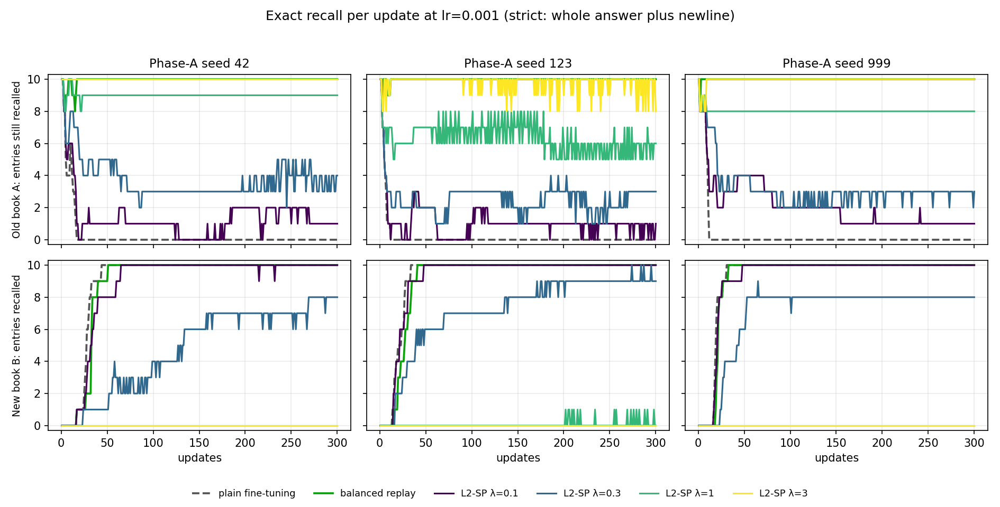
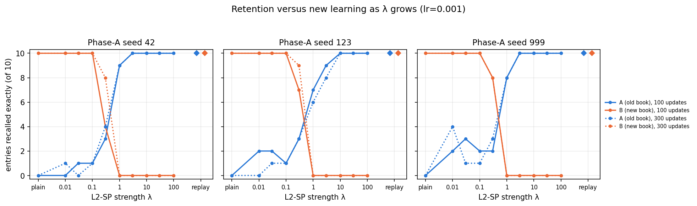
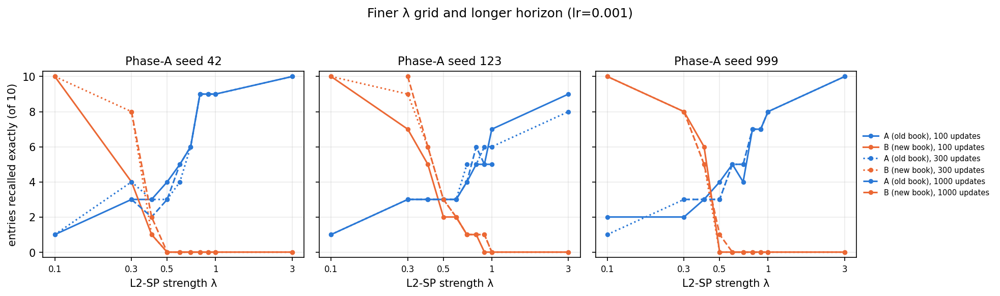
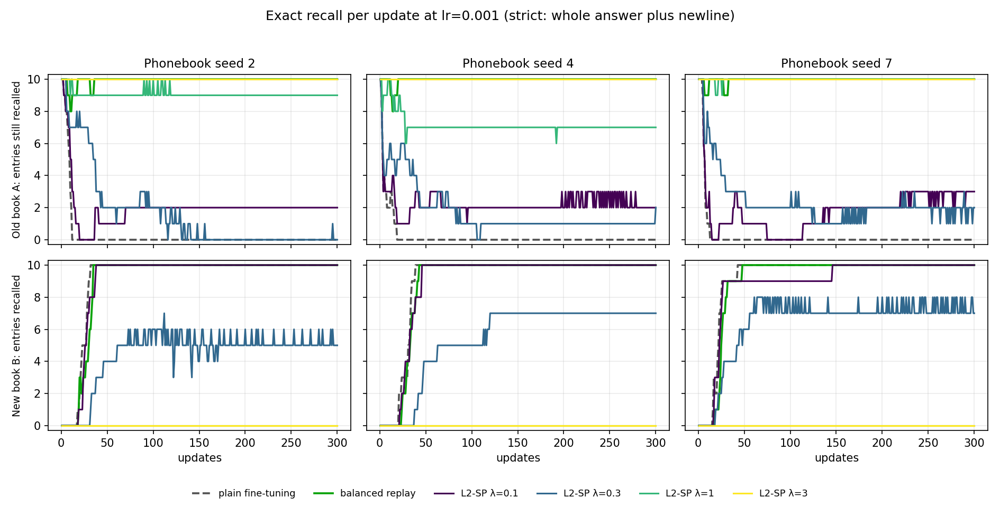
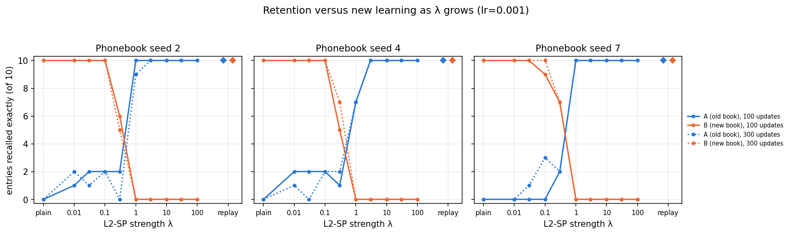
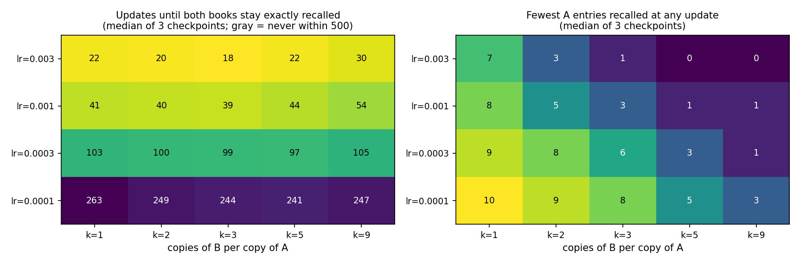

# Week of October 7–13: matched-optimization comparison and replication

Protocol written Saturday October 10, 2026, before any run below was executed.
Results are appended in later commits, so the history shows what was decided in advance.

## Why

Last week's [Part 10](../../sweep_lr/README.md#part-10--replay-learns-both-books-after-adjusting-optimization-settings)
showed that balanced replay reaches exact recall of both books at lr=0.001 and
100 updates, and that the earlier "replay cannot learn B" result came from
lr=0.0001. Every L2-SP result so far also used lr=0.0001, where no method learns
phonebook B within 100 updates. L2-SP has therefore never been tested where B is
learnable, and the L2-SP-versus-replay comparison is still unfair. This week closes that
gap, then checks whether the conclusions survive new phonebooks.

> **Precision note (added October 11, with the results).** "No method learns phonebook B"
> at lr=0.0001 and 100 updates is shorthand for "at most 3 of its 10 entries recalled
> exactly". That is what the committed runs show: the 43 B-only runs at lr=0.0001 and 100
> updates in [`sweep_lr/seeded/`](../../sweep_lr/seeded/) (plain fine-tuning and every
> L2-SP strength) end with B's teacher-forced sequence accuracy at 0 of 10 from the seed-42
> and seed-999 checkpoints and at most 3 of 10 from the seed-123 checkpoint, and balanced
> replay recalls at most 1 of 10
> ([last week's pilot](../week_2026-09-30/README.md)). The sentence above is left as
> originally committed.

## Evidence standard

- Every experiment is a committed JSON spec in `phonebook/specs/`. The runner
  (`phonebook/run_experiment.py`) writes `protocol.json` (spec, code commit,
  input and checkpoint hashes, environment) before any training.
- The runner refuses a dirty git tree and an existing output folder.
- Phase-A starting checkpoints are pinned by SHA-256 in the spec. E1 uses the
  same three checkpoints as last week; the pins are copied from last week's protocol.
- Each run records its command, return code, runtime and log hash. Every endpoint
  is evaluated by strict generation (exact answer plus newline, no length hint) on
  both books separately.
- Per-update curves come from the trainer's own `metrics.csv` with
  `--accuracy-interval 1`. Its teacher-forced sequence accuracy equals strict
  generation recall (identical on all 40 book evaluations last week); the audit
  re-checks this on every endpoint here.
- Training is deterministic with constant learning rate, so a 100-update run is
  the first 100 rows of a 300-update run. `e1_prefix_check` verifies this directly.
- Small evidence files are committed with `git add -f` (the folder is ignored).
  Model weights, prepared binaries and the per-epoch logs stay local; their hashes
  are in the manifest.

## E1: L2-SP versus plain fine-tuning versus balanced replay at lr=0.001

**Question.** Can L2-SP, which needs no old data, retain phonebook A and also learn
phonebook B once the optimizer can learn B? How does it compare with plain
fine-tuning and with balanced replay?

**Design.** Three Phase-A checkpoints (seeds 42, 123, 999), books A and B unchanged
(ten entries each, [phonebookA.txt](../../inputs/phonebookA.txt),
[phonebookB.txt](../../inputs/phonebookB.txt)). Every run starts from the Phase-A
checkpoint, uses lr=0.001, 300 updates (one per epoch), AdamW defaults of the
trainer, Phase-B seed 42, batch size 64, and evaluates book A as the validation set.

| Condition | Training data | L2-SP λ |
|---|---|---|
| plain | B | 0 |
| l2sp_lam… | B | 0.01, 0.03, 0.1, 0.3, 1, 3, 10, 30, 100 |
| replay_a1b1 | A once + B once | 0 |

That is 11 conditions × 3 checkpoints = 33 runs. [`e1_prefix_check`](../../specs/e1_prefix_check.json)
adds three 100-update runs on one checkpoint to confirm the prefix property.

**Decision rules (fixed now).**

- Primary endpoint: exact recall counts (of 10) for A and for B after 100 updates.
  Secondary: the same after 300 updates, and the full curves.
- L2-SP *matches replay* at a budget if one λ gives A=10/10 and B=10/10 on at least
  2 of the 3 checkpoints. It *nearly matches* if one λ gives A≥9/10 and B=10/10 on at
  least 2 of 3.
- The λ carried into the held-out replication (E2) is the one with the largest sum
  over the 3 checkpoints of (A + B) correct at 100 updates. Ties go to the larger
  summed A, then to the smaller λ.
- Every grid point is reported, including failures. Best-epoch-in-hindsight numbers
  are exploratory and never the headline.

**Reproduce.**

```bash
python phonebook/run_experiment.py --spec phonebook/specs/e1_matched_lr.json --dry-run
python phonebook/run_experiment.py --spec phonebook/specs/e1_matched_lr.json --out-root phonebook/experiments/week_2026-10-07/e1_matched_lr
python phonebook/run_experiment.py --spec phonebook/specs/e1_prefix_check.json --out-root phonebook/experiments/week_2026-10-07/e1_prefix_check
```

E2 (new phonebooks) and E3 (the README's repeated-B replay question) are specified
in later commits, each before its own runs.

## E1 results

Run Saturday October 10 from clean code commit `e877957`: 33 runs, all return
code 0, about 45 seconds each. Evidence is in [`e1_matched_lr/`](e1_matched_lr/)
and [`e1_prefix_check/`](e1_prefix_check/); derived tables and figures are in
[`../../results/`](../../results/): [`e1_endpoints.csv`](../../results/e1_endpoints.csv),
[`e1_decision.json`](../../results/e1_decision.json),
[`e1_curves.png`](../../results/e1_curves.png),
[`e1_dose_response.png`](../../results/e1_dose_response.png).
Every cell below is entries recalled exactly (whole answer plus newline), out of ten
per book: A is the old book, B the new one.


**After 100 updates** (entries of book A and of book B, out of 10 each, recalled exactly)

| Condition | seed 42 | seed 123 | seed 999 |
|---|---|---|---|
| plain fine-tuning | A 0, B 10 | A 0, B 10 | A 0, B 10 |
| L2-SP λ=0.01 | A 0, B 10 | A 2, B 10 | A 2, B 10 |
| L2-SP λ=0.03 | A 1, B 10 | A 2, B 10 | A 3, B 10 |
| L2-SP λ=0.1 | A 1, B 10 | A 1, B 10 | A 2, B 10 |
| L2-SP λ=0.3 | A 3, B 4 | A 3, B 7 | A 2, B 8 |
| L2-SP λ=1 | A 9, B 0 | A 7, B 0 | A 8, B 0 |
| L2-SP λ=3 | A 10, B 0 | A 9, B 0 | A 10, B 0 |
| L2-SP λ=10 | A 10, B 0 | A 10, B 0 | A 10, B 0 |
| L2-SP λ=30 | A 10, B 0 | A 10, B 0 | A 10, B 0 |
| L2-SP λ=100 | A 10, B 0 | A 10, B 0 | A 10, B 0 |
| balanced replay (A once + B once) | A 10, B 10 | A 10, B 10 | A 10, B 10 |

**After 300 updates** (entries of book A and of book B, out of 10 each, recalled exactly)

| Condition | seed 42 | seed 123 | seed 999 |
|---|---|---|---|
| plain fine-tuning | A 0, B 10 | A 0, B 10 | A 0, B 10 |
| L2-SP λ=0.01 | A 1, B 10 | A 0, B 10 | A 4, B 10 |
| L2-SP λ=0.03 | A 0, B 10 | A 1, B 10 | A 1, B 10 |
| L2-SP λ=0.1 | A 1, B 10 | A 1, B 10 | A 1, B 10 |
| L2-SP λ=0.3 | A 4, B 8 | A 3, B 9 | A 3, B 8 |
| L2-SP λ=1 | A 9, B 0 | A 6, B 0 | A 8, B 0 |
| L2-SP λ=3 | A 10, B 0 | A 8, B 0 | A 10, B 0 |
| L2-SP λ=10 | A 10, B 0 | A 10, B 0 | A 10, B 0 |
| L2-SP λ=30 | A 10, B 0 | A 10, B 0 | A 10, B 0 |
| L2-SP λ=100 | A 10, B 0 | A 10, B 0 | A 10, B 0 |
| balanced replay (A once + B once) | A 10, B 10 | A 10, B 10 | A 10, B 10 |

**Timing** (update numbers)

| Condition | seed 42 | seed 123 | seed 999 |
|---|---|---|---|
| plain fine-tuning: B first 10/10 | 44 | 34 | 31 |
| plain fine-tuning: lowest A | 0 (update 17) | 0 (update 12) | 0 (update 12) |
| balanced replay (A once + B once): B first 10/10 | 51 | 41 | 33 |
| balanced replay (A once + B once): lowest A | 8 (update 4) | 8 (update 3) | 8 (update 2) |
| balanced replay: both books 10/10 | 51 | 41 | 33 |

**Best L2-SP compromise (largest A + B)**

- after 100 updates: seed 42: 11/20 (λ=0.03, 0.1); seed 123: 12/20 (λ=0.01, 0.03); seed 999: 13/20 (λ=0.03)
- after 300 updates: seed 42: 12/20 (λ=0.3); seed 123: 12/20 (λ=0.3); seed 999: 14/20 (λ=0.01)





**Reading the table.**

1. *Plain fine-tuning forgets A before it learns B.* A is down to 0 of 10 by update
   17, 12 and 12 on the three checkpoints; B first reaches 10 of 10 at update 44, 34
   and 31. At 100 and at 300 updates the result is A 0, B 10 on every checkpoint.
2. *L2-SP trades one book for the other along a single axis of λ.*
   - λ ≤ 0.1 behaves like plain fine-tuning: B is complete by update 31 to 65, and A
     ends at 0 to 4 of 10 after 300 updates.
   - λ = 0.3 is the only intermediate point: A 3 to 4 and B 8 to 9 after 300 updates
     (B reaches 10 only on the seed 123 checkpoint, at update 274).
   - λ ≥ 1 keeps most or all of A (5 to 10 of 10 over the 300 updates at λ=1; always 8 or
     more at λ=3; 10 at λ ≥ 10) but learns essentially none of B: at most 1 of 10 at any
     single update.
3. *Pre-registered decision: no λ matches replay.* No λ gives A ≥ 9 together with B = 10
   on any of the three checkpoints at 100 or at 300 updates, so every λ fails both the
   "matches" and the "nearly matches" test
   ([`e1_decision.json`](../../results/e1_decision.json)). The best L2-SP compromise,
   the largest A + B on each checkpoint, is 11 to 13 of 20 entries after 100 updates and
   12 to 14 after 300, against 20 of 20 for balanced replay.
4. *Balanced replay reaches 10 of 10 on both books* at update 51, 41 and 33, after A
   dips to 8 of 10 for a few updates (lowest A at update 4, 3 and 2).

**Checks.**

- [`audit_experiment.py`](../../audit_experiment.py) passes on both evidence folders
  with local artifacts: it re-generated all 660 + 60 completions from the saved
  checkpoints and they equal the saved strings; spec and config equal the versions
  committed at `e877957`; Phase-A checkpoint hashes equal the pins.
- The trainer's logged teacher-forced recall equals strict generation recall at the
  endpoint of all 33 runs (checked inside the audit).
- `e1_prefix_check`: the 100-update runs equal the first 100 rows of the 300-update
  runs on all three conditions (100 epochs compared each, no mismatch, timing column
  ignored), so the 100-update numbers above come from the long runs legitimately.

**What this does not show.** One fixed pair of phonebooks (E2 tests new ones); one
learning rate; the trainer's AdamW defaults including weight decay 0.1; ten entries
per book, so counts move in tenths. L2-SP here is the isotropic penalty from the
mitigation notes; a Fisher-weighted penalty (EWC) was not tested. A "no" for L2-SP
at these settings is not a claim about every regularizer.

## E1b: a finer λ grid and a longer horizon (follow-up to E1)

*Added Saturday October 10, after E1's runs finished and before any E1b run. Not part of E1's original protocol.*

E1's half-decade λ grid is coarse next to the range where L2-SP stops learning B,
and 300 updates may be short for strong penalties. A "no L2-SP setting matches
replay" conclusion should survive a finer grid and a longer horizon. E1b runs
λ ∈ {0.3, 0.4, …, 1.0} on the same three checkpoints for 1000 updates, logged every
5 updates ([`e1b_fine_grid_long_horizon.json`](../../specs/e1b_fine_grid_long_horizon.json)).

**Decision rule.** E1's rule, unchanged, applied at 100, 300 and 1000 updates. The
100- and 300-update budgets use the union of E1's and E1b's λ values; the 1000-update
budget uses E1b's. **Cross-check:** the λ=0.3 and λ=1.0 rows at updates 5, 10, …, 300
must equal E1's rows at the same updates.

## E2: does E1 hold on new phonebooks?

*Added Saturday October 10, before any E2 run.*

E1 used one fixed pair of phonebooks. E2 repeats E1 exactly (same 11 conditions,
learning rate, updates, per-update logging and decision rules) on three new 20-entry
phonebooks. The whole grid is repeated, so no λ is carried over and E1's
"λ for replication" rule is not needed. This changes no E1 result or rule.

**Phonebooks.** Made with the README's own generator (`create_phonebook.py 20 --seed S`);
the first ten entries are book A and the last ten book B. A seed qualifies only if A
and B have the same longest line, because the trainer sizes its context from the
training book alone. Seed 1 crashes Phase A (longest lines 28 and 31); seed 3 trains,
but its checkpoint cannot be loaded for Phase B (28 versus 29). Seeds 2, 4 and 7 are
the first three that qualify; the choice depends only on name lengths, never on a
result. [`make_heldout_dataset.py`](../../make_heldout_dataset.py) enforces the rule.

**Phase A.** One fresh Phase-A model per phonebook (default config, lr=0.001, 100
updates, seed 42): [`e2_phase_a.json`](../../specs/e2_phase_a.json). Gate: each must
recall all ten entries of its own book A exactly; otherwise it is retrained from
scratch with 200, then 400 updates, keeping every attempt. The E2 spec pins the
resulting checkpoint hashes.

**Replication criteria (fixed now).** E1's conclusions replicate if, on at least 2 of
the 3 new phonebooks: (i) balanced replay recalls 10/10 of both books after 100
updates; (ii) plain fine-tuning ends 300 updates with B=10/10 and at most 2 of A
recalled; and (iii) the L2-SP decision rule, applied to the 3 new phonebooks over the
same grid, gives the same verdict as E1 at both 100 and 300 updates.

## E3: the README's replay question, A once plus B repeated k times

*Added Saturday October 10, before any E3 run.*

The phonebook README asks: if the replay data holds one copy of A and k copies of B,
how does k affect forgetting, and which k permits the fastest learning of 100%
accuracy on all data? E1's `replay_a1b1` is the k=1 case.

**Design.** The three E1 checkpoints (hash-pinned) × k ∈ {1, 2, 3, 5, 9} ×
lr ∈ {0.003, 0.001, 0.0003, 0.0001} = 60 runs, 500 updates, batch size 128 (so even
k=9, 100 sequences, is one update per epoch), per-update logging
([`e3_replay_ratio.json`](../../specs/e3_replay_ratio.json)).

**Metrics and rules (fixed now).**

- *first_joint*: first update at which every training sequence, hence both books, is
  recalled exactly. *stable_joint*: first update from which every logged update through
  update 500 has both books recalled exactly; runs that never get there are censored and
  count as infinitely slow.
- For each lr, k\* is the k with the smallest median stable_joint over the three
  checkpoints; ties go to the smaller k; if every k is censored there is no k\*. The
  question is whether k\*>1 for any lr.
- *Dip*: the minimum number of A entries recalled at any update, and the update where it
  first occurs.
- **Cross-checks.** k=1 at lr=0.001 must reproduce E1's `replay_a1b1` curves exactly
  (batch size 64 versus 128 is irrelevant for a single batch). k=1 at lr=0.0001 must
  reproduce last week's 100-update results: B recalled 0/10, 1/10 and 0/10 on the three
  checkpoints.
- Every cell is reported, including censored ones.

**Reproduce.**

```bash
python phonebook/run_experiment.py --spec phonebook/specs/e1b_fine_grid_long_horizon.json --out-root phonebook/experiments/week_2026-10-07/e1b_fine_grid_long_horizon
python phonebook/run_experiment.py --spec phonebook/specs/e2_phase_a.json --out-root phonebook/experiments/week_2026-10-07/e2_phase_a
python phonebook/run_experiment.py --spec phonebook/specs/e2_heldout_phonebooks.json --out-root phonebook/experiments/week_2026-10-07/e2_heldout_phonebooks
python phonebook/run_experiment.py --spec phonebook/specs/e3_replay_ratio.json --out-root phonebook/experiments/week_2026-10-07/e3_replay_ratio
```

**Audit and derived results** (after the runs; every command reads only the evidence folders):

```bash
python phonebook/audit_experiment.py --root phonebook/experiments/week_2026-10-07/e1_matched_lr --require-local-artifacts
python phonebook/report_experiments.py grid --root phonebook/experiments/week_2026-10-07/e1_matched_lr --out phonebook/results --prefix e1
python phonebook/report_experiments.py e1b --e1 phonebook/experiments/week_2026-10-07/e1_matched_lr --e1b phonebook/experiments/week_2026-10-07/e1b_fine_grid_long_horizon --out phonebook/results
python phonebook/report_experiments.py e2 --root phonebook/experiments/week_2026-10-07/e2_heldout_phonebooks --reference phonebook/results/e1_decision.json --out phonebook/results
python phonebook/report_experiments.py e3 --root phonebook/experiments/week_2026-10-07/e3_replay_ratio --e1 phonebook/experiments/week_2026-10-07/e1_matched_lr --out phonebook/results
```

## d1: does the logging interval change the training trajectory? (diagnostic)

*Added Sunday October 11, after E1b's runs and before any d1 run. Not part of the
original protocol.*

E1b's pre-registered cross-check against E1 failed (see the E1b results). An E1b run and
the E1 run it should repeat differ only in `--accuracy-interval` (5 versus 1) and
`--epochs` (1000 versus 300); the code is identical. Reading `train.py`: each accuracy
evaluation iterates two extra `DataLoader`s, and every new `DataLoader` iterator draws a
base seed from the global random generator even with `shuffle=False` (checked directly
with `torch.get_rng_state()`). So the interval changes the shuffle order of the single
training batch. That order is mathematically irrelevant but changes floating-point
rounding.

**Not blind.** Before writing this spec I re-ran one E1b setting outside the repository
(seed 42, λ=0.3, 100 updates) twice, once at interval 5 and once at interval 1; the first
reproduced E1b's rows and the second reproduced E1's. d1 repeats the interval-5 case under
the runner on all three checkpoints, so that the evidence is committed and audited.

**Design.** λ=0.3, lr=0.001, 100 updates, logged every 5 updates, training on B only,
the three E1 checkpoints (hash-pinned), 3 runs
([`d1_logging_interval.json`](../../specs/d1_logging_interval.json)).

**Predictions (fixed now).**

- P1: each d1 run equals the first 100 updates of the corresponding E1b run (same
  interval 5, 1000 updates in E1b) in every logged column except timing.
- P2: each d1 run differs from E1's λ=0.3 run (interval 1) at the shared updates.

If P1 holds, the number of epochs is irrelevant and the interval alone explains why runs
are identical or not. If P2 also holds, the interval is sufficient to explain E1b's failed
cross-check. If P1 fails, something else differs between runs and the explanation is
wrong. Every outcome is reported.

**Reproduce.**

```bash
python phonebook/run_experiment.py --spec phonebook/specs/d1_logging_interval.json --out-root phonebook/experiments/week_2026-10-07/d1_logging_interval
python phonebook/audit_experiment.py --root phonebook/experiments/week_2026-10-07/d1_logging_interval --require-local-artifacts --output phonebook/experiments/week_2026-10-07/d1_logging_interval/audit.json
python phonebook/report_experiments.py compare --a phonebook/experiments/week_2026-10-07/d1_logging_interval --b phonebook/experiments/week_2026-10-07/e1b_fine_grid_long_horizon --pair d0_seed42:l2sp_lam0.3_iv5_ep100:l2sp_lam0.3 --pair d0_seed123:l2sp_lam0.3_iv5_ep100:l2sp_lam0.3 --pair d0_seed999:l2sp_lam0.3_iv5_ep100:l2sp_lam0.3 --max-epoch 100 --out phonebook/experiments/week_2026-10-07/d1_logging_interval/compare_with_e1b.json
python phonebook/report_experiments.py compare --a phonebook/experiments/week_2026-10-07/d1_logging_interval --b phonebook/experiments/week_2026-10-07/e1_matched_lr --pair d0_seed42:l2sp_lam0.3_iv5_ep100:l2sp_lam0.3 --pair d0_seed123:l2sp_lam0.3_iv5_ep100:l2sp_lam0.3 --pair d0_seed999:l2sp_lam0.3_iv5_ep100:l2sp_lam0.3 --max-epoch 100 --out phonebook/experiments/week_2026-10-07/d1_logging_interval/compare_with_e1.json
```

The last command is expected to exit with status 1 (it reports the mismatches P2 predicts).

## E1b results

Run overnight, Saturday October 10 at 23:47 to Sunday October 11 at 00:41 (local time), from clean code commit `5f4a034`: 24 runs (λ = 0.3, 0.4, …, 1.0 on
three checkpoints, 1000 updates each, logged every 5 updates), all return code 0, 84 to 320
seconds each (median 123). Evidence is in
[`e1b_fine_grid_long_horizon/`](e1b_fine_grid_long_horizon/); derived tables and the figure
are in [`../../results/`](../../results/):
[`e1b_endpoints.csv`](../../results/e1b_endpoints.csv),
[`e1b_decision.json`](../../results/e1b_decision.json),
[`e1b_vs_e1.json`](../../results/e1b_vs_e1.json),
[`e1b_fine_grid.png`](../../results/e1b_fine_grid.png).
Cells are entries recalled exactly, out of ten per book.

**Recall after 100, 300 and 1000 updates** (A and B entries recalled exactly, of 10 each)

| λ | seed 42 | seed 123 | seed 999 |
|---|---|---|---|
| 0.3 | 100: A 3, B 4 · 300: A 4, B 8 · 1000: A 3, B 8 | 100: A 3, B 7 · 300: A 3, B 10 · 1000: A 3, B 10 | 100: A 2, B 8 · 300: A 3, B 8 · 1000: A 3, B 8 |
| 0.4 | 100: A 3, B 1 · 300: A 3, B 1 · 1000: A 2, B 2 | 100: A 3, B 5 · 300: A 3, B 6 · 1000: A 3, B 6 | 100: A 3, B 6 · 300: A 3, B 5 · 1000: A 3, B 5 |
| 0.5 | 100: A 4, B 0 · 300: A 3, B 0 · 1000: A 3, B 0 | 100: A 3, B 2 · 300: A 3, B 3 · 1000: A 3, B 3 | 100: A 4, B 0 · 300: A 3, B 0 · 1000: A 3, B 1 |
| 0.6 | 100: A 5, B 0 · 300: A 4, B 0 · 1000: A 5, B 0 | 100: A 3, B 2 · 300: A 3, B 2 · 1000: A 3, B 2 | 100: A 5, B 0 · 300: A 5, B 0 · 1000: A 5, B 0 |
| 0.7 | 100: A 6, B 0 · 300: A 6, B 0 · 1000: A 6, B 0 | 100: A 4, B 1 · 300: A 5, B 1 · 1000: A 4, B 1 | 100: A 4, B 0 · 300: A 5, B 0 · 1000: A 5, B 0 |
| 0.8 | 100: A 9, B 0 · 300: A 9, B 0 · 1000: A 9, B 0 | 100: A 5, B 1 · 300: A 5, B 1 · 1000: A 6, B 1 | 100: A 7, B 0 · 300: A 7, B 0 · 1000: A 7, B 0 |
| 0.9 | 100: A 9, B 0 · 300: A 9, B 0 · 1000: A 9, B 0 | 100: A 5, B 0 · 300: A 6, B 1 · 1000: A 5, B 1 | 100: A 7, B 0 · 300: A 7, B 0 · 1000: A 7, B 0 |
| 1 | 100: A 9, B 0 · 300: A 9, B 0 · 1000: A 9, B 0 | 100: A 8, B 0 · 300: A 6, B 0 · 1000: A 5, B 0 | 100: A 8, B 0 · 300: A 8, B 0 · 1000: A 8, B 0 |

**Pre-registered decision over the union of E1 and E1b λ values**

- after 100 updates: **no**; no λ qualifies
- after 300 updates: **no**; no λ qualifies
- after 1000 updates: **no**; no λ qualifies

**Best compromise (largest A + B)**

- after 100 updates: seed 42: 9/20 (λ=0.8, 0.9, 1); seed 123: 10/20 (λ=0.3); seed 999: 10/20 (λ=0.3)
- after 300 updates: seed 42: 12/20 (λ=0.3); seed 123: 13/20 (λ=0.3); seed 999: 11/20 (λ=0.3)
- after 1000 updates: seed 42: 11/20 (λ=0.3); seed 123: 13/20 (λ=0.3); seed 999: 11/20 (λ=0.3)



**Reading the table.**

1. *Pre-registered decision: no λ matches replay at any budget.* Over the union of E1's
   and E1b's λ values, no λ gives A ≥ 9 together with B = 10 on even one checkpoint after
   100, 300 or 1000 updates, so every λ fails both the "matches" and the "nearly matches"
   test ([`e1b_decision.json`](../../results/e1b_decision.json)).
2. *There is no λ where both books are recalled.* Among the 72 (λ, checkpoint, budget)
   cells, A ≥ 8 occurs only with B = 0, and B ≥ 8 occurs only at λ = 0.3, with A at most 4.
   No cell has both A ≥ 5 and B ≥ 5. The largest A + B is 13 of 20 (balanced replay: 20).
3. *Longer training does not open a window.* For λ ≥ 0.5, B is at most 3 at every budget
   and moves by at most 1 between 100 and 1000 updates; A moves by at most 3 (seed 123 at
   λ = 1: 8, 6, 5 after 100, 300, 1000 updates, so retention erodes slowly). At λ = 0.3, B
   grows or holds with training (seed 42: 4, 8, 8; seed 123: 7, 10, 10; seed 999: 8, 8, 8)
   while A stays at 2 to 4.

**The pre-registered cross-check failed.** 6 run pairs (λ = 0.3 and λ = 1 on three checkpoints) were compared at their 60 shared
updates up to 300, 360 in all. 771 logged cells differ: at 263 of the 360 updates in at
least one column, and at 74 of them in the exact-recall counts. The A count differs at 60
updates (by one entry at 57, two entries at 2, three entries at 1) and the B count at 23
(by one entry at 22, two entries at 1). Differences first appear between update 20 and
200, and in the counts between update 60 and 125 (two of the six pairs never differ in the
counts within 300 updates).

*Cause.* The E1b protocol says its λ=0.3 and λ=1 rows "must equal" E1's. That assumed the
logging interval cannot affect training. It can: `train.py` evaluates by iterating
data loaders, every new `DataLoader` iterator draws from the global random generator even
with `shuffle=False`, so evaluating every 5th update instead of every update changes the
shuffle order of the single training batch. The order is mathematically irrelevant, but it
changes floating-point rounding, and the training dynamics amplify the difference.
The d1 diagnostic below confirms it: three 100-update runs logged every 5 updates
reproduce the corresponding E1b runs exactly (20 shared updates each, 0 mismatching cells)
and differ from E1's (32, 9 and 32 mismatching cells). The check therefore holds only between runs with the same logging interval, as
in `e1_prefix_check` and in E3's k=1 check at lr=0.001.

*What it means for E1b.* The E1b runs are second draws of the same protocol with a
different shuffle order. At the budgets the decision uses, the two draws agree closely:

| Condition | seed 42 | seed 123 | seed 999 |
|---|---|---|---|
| L2-SP λ=0.3, 100 updates | E1: A 3, B 4; E1b: A 3, B 4 | E1: A 3, B 7; E1b: A 3, B 7 | E1: A 2, B 8; E1b: A 2, B 8 |
| L2-SP λ=1, 100 updates | E1: A 9, B 0; E1b: A 9, B 0 | E1: A 7, B 0; E1b: A 8, B 0 | E1: A 8, B 0; E1b: A 8, B 0 |
| L2-SP λ=0.3, 300 updates | E1: A 4, B 8; E1b: A 4, B 8 | E1: A 3, B 9; E1b: A 3, B 10 | E1: A 3, B 8; E1b: A 3, B 8 |
| L2-SP λ=1, 300 updates | E1: A 9, B 0; E1b: A 9, B 0 | E1: A 6, B 0; E1b: A 6, B 0 | E1: A 8, B 0; E1b: A 8, B 0 |

22 of the 24 counts are identical; the largest difference between the two runs at the same update is 1 entry.
In none of these runs is A ≥ 9 together with B = 10, so the pre-registered verdict does not depend on which of the two runs is used for a shared λ.

So single counts in the regime-change region (λ about 0.3 to 1) carry about one entry of
numerical noise, occasionally more at a single update. The pre-registered verdict is far
from that margin (B ≥ 8 needs λ ≤ 0.3 and then A is at most 4, against the 9 required).
For the 100- and 300-update decisions the union takes E1's run at λ = 0.3 and λ = 1.

**What this does not show.** Three checkpoints and one pair of phonebooks (E2 tests new
ones); one learning rate; isotropic L2-SP only; one Phase-B shuffle stream per run apart
from the replicate above.

## E2 results

Run on Sunday October 11 between 00:41 and 01:19 (local time), from clean code commit `5f4a034`: 33 runs (E1's 11 conditions on
three new phonebooks, made with seeds 2, 4 and 7), all return code 0, 45 to 104 seconds
each (median 66). Each phonebook's Phase-A model passed its gate on the first attempt: all
ten entries of its own book A recalled exactly after 100 updates, none of book B
([`e2_phase_a/`](e2_phase_a/)). Evidence is in
[`e2_heldout_phonebooks/`](e2_heldout_phonebooks/); derived tables and figures are in
[`../../results/`](../../results/):
[`e2_endpoints.csv`](../../results/e2_endpoints.csv),
[`e2_decision.json`](../../results/e2_decision.json),
[`e2_replication.json`](../../results/e2_replication.json),
[`e2_curves.png`](../../results/e2_curves.png),
[`e2_dose_response.png`](../../results/e2_dose_response.png).
Cells are entries recalled exactly, out of ten per book.

**After 100 updates** (entries of book A and of book B, out of 10 each, recalled exactly)

| Condition | phonebook 2 | phonebook 4 | phonebook 7 |
|---|---|---|---|
| plain fine-tuning | A 0, B 10 | A 0, B 10 | A 0, B 10 |
| L2-SP λ=0.01 | A 1, B 10 | A 2, B 10 | A 0, B 10 |
| L2-SP λ=0.03 | A 2, B 10 | A 2, B 10 | A 0, B 10 |
| L2-SP λ=0.1 | A 2, B 10 | A 2, B 10 | A 0, B 9 |
| L2-SP λ=0.3 | A 2, B 6 | A 1, B 5 | A 2, B 7 |
| L2-SP λ=1 | A 10, B 0 | A 7, B 0 | A 10, B 0 |
| L2-SP λ=3 | A 10, B 0 | A 10, B 0 | A 10, B 0 |
| L2-SP λ=10 | A 10, B 0 | A 10, B 0 | A 10, B 0 |
| L2-SP λ=30 | A 10, B 0 | A 10, B 0 | A 10, B 0 |
| L2-SP λ=100 | A 10, B 0 | A 10, B 0 | A 10, B 0 |
| balanced replay (A once + B once) | A 10, B 10 | A 10, B 10 | A 10, B 10 |

**After 300 updates** (entries of book A and of book B, out of 10 each, recalled exactly)

| Condition | phonebook 2 | phonebook 4 | phonebook 7 |
|---|---|---|---|
| plain fine-tuning | A 0, B 10 | A 0, B 10 | A 0, B 10 |
| L2-SP λ=0.01 | A 2, B 10 | A 1, B 10 | A 0, B 10 |
| L2-SP λ=0.03 | A 1, B 10 | A 0, B 10 | A 1, B 10 |
| L2-SP λ=0.1 | A 2, B 10 | A 2, B 10 | A 3, B 10 |
| L2-SP λ=0.3 | A 0, B 5 | A 2, B 7 | A 2, B 7 |
| L2-SP λ=1 | A 9, B 0 | A 7, B 0 | A 10, B 0 |
| L2-SP λ=3 | A 10, B 0 | A 10, B 0 | A 10, B 0 |
| L2-SP λ=10 | A 10, B 0 | A 10, B 0 | A 10, B 0 |
| L2-SP λ=30 | A 10, B 0 | A 10, B 0 | A 10, B 0 |
| L2-SP λ=100 | A 10, B 0 | A 10, B 0 | A 10, B 0 |
| balanced replay (A once + B once) | A 10, B 10 | A 10, B 10 | A 10, B 10 |

**Timing** (update numbers)

| Condition | phonebook 2 | phonebook 4 | phonebook 7 |
|---|---|---|---|
| plain fine-tuning: B first 10/10 | 32 | 39 | 43 |
| plain fine-tuning: lowest A | 0 (update 12) | 0 (update 19) | 0 (update 13) |
| balanced replay (A once + B once): B first 10/10 | 35 | 43 | 48 |
| balanced replay (A once + B once): lowest A | 8 (update 10) | 8 (update 14) | 9 (update 7) |
| balanced replay: both books 10/10 | 36 | 43 | 48 |

**Best L2-SP compromise (largest A + B)**

- after 100 updates: phonebook 2: 12/20 (λ=0.03, 0.1); phonebook 4: 12/20 (λ=0.01, 0.03, 0.1); phonebook 7: 10/20 (λ=0.01, 0.03, 1, 3, 10, 30, 100)
- after 300 updates: phonebook 2: 12/20 (λ=0.01, 0.1); phonebook 4: 12/20 (λ=0.1); phonebook 7: 13/20 (λ=0.1)





**Reading the tables.**

1. *All three pre-registered replication criteria hold on 3 of 3 phonebooks.*
   (i) Balanced replay recalls 10 of 10 of both books after 100 updates (and after 300).
   (ii) Plain fine-tuning ends 300 updates with B 10 of 10 and A 0 of 10. (iii) The L2-SP
   decision rule gives "no" at 100 and at 300 updates, the same verdict as E1
   ([`e2_replication.json`](../../results/e2_replication.json)). E1's conclusions replicate.
2. *The L2-SP trade-off has the same shape.* λ ≤ 0.1 behaves like plain fine-tuning (B 9
   to 10, A 0 to 3 of 10); λ = 0.3 is the only intermediate point (A 0 to 2, B 5 to 7);
   λ ≥ 1 keeps A (7 to 10 of 10, and 10 at λ ≥ 3) but recalls none of B. Among the 54
   (λ, phonebook, budget) cells, A ≥ 8 occurs only with B = 0, B ≥ 8 occurs only with A at
   most 3, and no cell has both A ≥ 5 and B ≥ 5. The best L2-SP total A + B is 10 to 13 of
   20, against 20 for balanced replay.
3. *Plain fine-tuning and replay behave as in E1.* Plain fine-tuning first reaches B 10 of
   10 at update 32, 39 and 43, with A down to 0 by update 12, 19 and 13. Balanced replay
   recalls both books from update 36, 43 and 48 on, after A dips to 8, 8 and 9 of 10
   (lowest A at update 10, 14 and 7).

**What this does not show.** Three new phonebooks of the same kind (20 random entries from
the README's generator, seeds chosen only by name length, the same model size): it tests
whether E1's result was specific to one pair of books, not whether it holds for other kinds
of data. One Phase-B shuffle stream per run (see d1: counts in the regime-change region
carry about one entry of noise).

## E3 results

Run overnight, Saturday October 10 at 23:47 to Sunday October 11 at 01:54 (local time), from clean code commit `5f4a034`: 60 runs (k = 1, 2, 3, 5, 9 copies
of B per copy of A, at lr = 0.003, 0.001, 0.0003 and 0.0001, on the three E1 checkpoints),
500 updates each, logged every update, all return code 0, 66 to 280 seconds each (median
112). All 60 runs end with both books recalled 10 of 10; none is censored, and in every run
both books stayed recalled once they were first recalled (first_joint equals stable_joint).
Evidence is in [`e3_replay_ratio/`](e3_replay_ratio/); derived tables and the figure are in
[`../../results/`](../../results/):
[`e3_cells.csv`](../../results/e3_cells.csv) (one row per run),
[`e3_table.csv`](../../results/e3_table.csv),
[`e3_best_k.json`](../../results/e3_best_k.json),
[`e3_cross_checks.json`](../../results/e3_cross_checks.json),
[`e3_heatmaps.png`](../../results/e3_heatmaps.png).

**Updates until both books are recalled exactly, and stay so (median over the three checkpoints)**

| learning rate | k=1 | k=2 | k=3 | k=5 | k=9 |
|---|---|---|---|---|---|
| 0.003 | 22 | 20 | 18 | 22 | 30 |
| 0.001 | 41 | 40 | 39 | 44 | 54 |
| 0.0003 | 103 | 100 | 99 | 97 | 105 |
| 0.0001 | 263 | 249 | 244 | 241 | 247 |

**Fewest entries of the old book A recalled at any update (median over the three checkpoints, with the range)**

| learning rate | k=1 | k=2 | k=3 | k=5 | k=9 |
|---|---|---|---|---|---|
| 0.003 | 7 (5 to 8) | 3 (3 to 5) | 1 (0 to 2) | 0 (0 to 1) | 0 (0 to 0) |
| 0.001 | 8 (8 to 8) | 5 (5 to 7) | 3 (2 to 5) | 1 (0 to 3) | 1 (0 to 1) |
| 0.0003 | 9 (9 to 10) | 8 (8 to 8) | 6 (6 to 8) | 3 (2 to 6) | 1 (0 to 4) |
| 0.0001 | 10 (9 to 10) | 9 (8 to 10) | 8 (8 to 8) | 5 (5 to 8) | 3 (2 to 5) |

**Best k per learning rate** (smallest median stable update; ties to the smaller k): lr = 0.003: k = 3; lr = 0.001: k = 3; lr = 0.0003: k = 5; lr = 0.0001: k = 5.



**Cross-checks (pre-registered): both pass.** k=1 at lr=0.001 against E1's balanced replay: 3 checkpoints, 900 logged updates compared,
0 mismatches. k=1 at lr=0.0001: B is recalled after 100 updates in 0, 1, 0 of 10 entries
on the three checkpoints, the same as last week's pilot (0, 1, 0), although the pilot
logged every 10 updates.

**Reading the tables.**

1. *The pre-registered question: k\* > 1 at every learning rate.* By the rule (smallest
   median stable_joint, ties to the smaller k), k\* is 3 at lr = 0.003 and 0.001 and 5 at
   lr = 0.0003 and 0.0001.
2. *The gain over k = 1 is small, and the choice among k = 2, 3, 5 is not resolved.* Compared
   with k = 1, k\* needs 4, 2, 6 and 22 fewer updates (18%, 5%, 6% and 8%). The medians for
   k = 2, 3 and 5 lie within 3 to 8 updates of each other at each learning rate, and
   run-to-run noise in the timing was not measured. Exact-recall counts move by about one
   entry under a shuffle-order change (E1b against E1), so a few updates should not be read
   as a real difference. Treat "k = 2 to 5 are all a little faster than k = 1" as the finding, not the
   specific k\*.
3. *Paired comparison with k = 1 (exploratory, not pre-registered).*

   | k | faster than k=1 | tied | slower | sign test p | median change (updates) |
   |---|---|---|---|---|---|
   | 2 | 11 of 12 | 0 | 1 | 0.0063 | -2.5 |
   | 3 | 10 of 12 | 0 | 2 | 0.0386 | -4 |
   | 5 | 9 of 12 | 1 | 2 | 0.0654 | -4.5 |
   | 9 | 4 of 12 | 0 | 8 | 0.3877 | +5.5 |

   The 12 pairs are not independent (the same three checkpoints appear at all four
   learning rates) and four comparisons are made without correction, so the p-values are
   descriptive. k = 2 is faster than k = 1 in 11 of 12 pairs, k = 3 in 10 of 12, k = 5 in 9
   of 12; k = 9 is slower in 8 of 12.
4. *k = 9 is not faster.* Its median is slower than k = 1 at lr = 0.003 (30 versus 22),
   0.001 (54 versus 41) and 0.0003 (105 versus 103), and faster only at lr = 0.0001 (247
   versus 263).
5. *The dip in A deepens with k.* At lr = 0.001 the median fewest A entries recalled at any
   update is 8, 5, 3, 1 and 1 for k = 1, 2, 3, 5 and 9; at lr = 0.003 it is 7, 3, 1, 0 and
   0. A was forgotten entirely, then relearned, on at least one checkpoint at (lr, k) =
   (0.003, 3), (0.003, 5), (0.003, 9), (0.001, 5), (0.001, 9) and (0.0003, 9). Every run
   ends with A at 10 of 10.
6. *The learning rate matters far more than k.* For k = 3 the median is 18, 39, 99 and 244
   updates at lr = 0.003, 0.001, 0.0003 and 0.0001.

**What this does not show.** The metric is updates, not work: at k = 5 each update processes
60 sequences against 20 at k = 1, so counted in sequences seen k = 1 is the cheapest. Three
checkpoints (medians of three), one pair of phonebooks, one batch per update (batch size
128), and no replicate runs to put an error bar on a few updates.

## d1 results

Run on Sunday October 11 between 13:48 and 13:49 (local time), from clean code commit `d555d4c`: 3 runs (λ = 0.3, lr = 0.001, 100
updates, logged every 5 updates, one per checkpoint), all return code 0, 20 to 24 seconds
each. The audit passes (60 completions). Evidence is in
[`d1_logging_interval/`](d1_logging_interval/); comparisons in
[`compare_with_e1b.json`](d1_logging_interval/compare_with_e1b.json) and
[`compare_with_e1.json`](d1_logging_interval/compare_with_e1.json).

- **P1 holds.** Each run equals the first 100 updates of the corresponding E1b run on all three checkpoints (20 shared updates each, 0 mismatching cells).
- **P2 holds.** Each run differs from E1's λ = 0.3 run at the shared updates (32, 9 and 32 mismatching cells in 20 shared updates each).

With the same code, data and seed, the logging interval alone changes the trajectory, and
the number of epochs does not. This explains E1b's failed cross-check; it does not make
E1b's runs wrong, only different draws.

**Consequences.** Compare runs only at the same `--accuracy-interval`. E1, E2 and E3 all
log every update, so a setting they share can be compared exactly (E3's k = 1 check at
lr = 0.001 is identical to E1's replay). E1b logs every 5 updates and is a separate draw. A fix
would give the training `DataLoader` its own `torch.Generator`, so that evaluation cannot
move it; it was not made, because it would change the numbers of every committed run.

## AI assistance

Claude Code assisted with the code, experiments, audit and writing this week.
